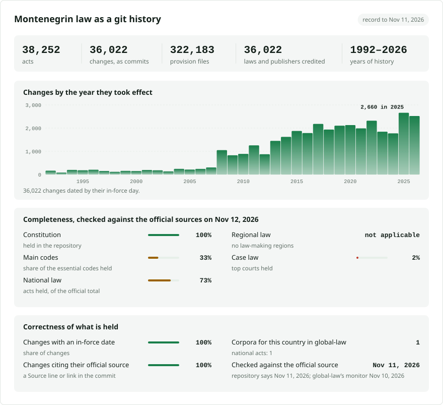

# Montenegro: law history in git

**English** · **[Ili pročitajte na crnogorskom](README.md)**

<picture>
<source media="(prefers-color-scheme: dark)" srcset="data/effort-dark.svg">

</picture>

The law of Montenegro as a git history: one file per article, one commit per version on the day it took effect, and the act that made it as the commit's author. The Službeni list publishes no consolidated texts, so every act is here as published, and only the Constitution has later versions: its 21 amendments are applied to the articles they replace. `git blame` names the amendment behind every line of the Constitution; `git log` lists every change to an article; picking a date gives the text in force that day.

Part of [lexifina/global-law](https://github.com/lexifina/global-law), one git history for every country's law: this is Montenegro's national law, which global-law reads at `montenegro/national/acts/`.

**What is in it now:** the Constitution and 36,000 acts in force from the Službeni list's legal information system (PIS), national and municipal, each as published: 1,122 laws, 1,094 Government decrees, 3,582 rulebooks, 27,535 decisions and rulings, 142 international treaties and 2,525 other acts (orders, instructions, rules, rules of procedure, statutes, programmes, plans); 4,301 of them are amending acts. [`ACTS.md`](ACTS.md) lists every act, by kind; [`data/held.json`](data/held.json) lists the acts in force that are not here yet, each with the reason.

Each act is in `<kind>/<year>/<PIS id>/`, by the year it was published (`zakon/2019/312153/` is the Zakon o radu, the Labour Law, Službeni list Crne Gore 74/2019); decisions, more than a thousand a year, also sit under the month they were published (`odluka/<year>/<month>/<PIS id>/`). The Constitution is in [`ustav/`](ustav/). `data/paths.json` maps each act id to its folder.

The text is in Montenegrin, as the Službeni list publishes it: the 2007 Constitution in Cyrillic, its amendments and almost every other act in Latin; nothing is transliterated. An English translation is not part of this record.

## Questions as git commands

| Question | Command |
| --- | --- |
| Every change to Article 91 of the Constitution | `git log -p --word-diff -- ustav/clan-091.md` |
| Which amendment wrote each line of Article 91? | `git blame ustav/clan-091.md` |
| Every version of the Constitution, with the day each took effect | `git log --format="%h %(trailers:key=In-force,valueonly,separator=) %an" -- ustav ':!ustav/README.md'` |
| Article 91 as in force on 1 January 2020 | `python tools/on.py 2020-01-01 ustav clan-091` |

Any other act on a date: `python tools/on.py 2025-06-01 zakon/2019/312153`.

**Outside git**, we also host this record publicly, for free:

- **[Ask Claude about Montenegrin law](https://global-law.lexifina.com/v1/try_claude?country=montenegro)**: opens Claude with a first question ready.
- **[Ask ChatGPT](https://global-law.lexifina.com/v1/try_chatgpt?country=montenegro)**: the same question in ChatGPT.
- **[Search Montenegrin law on our site](https://lexifina.com/law?country=montenegro&q=godi%C5%A1nji+odmor)**: a search for "godišnji odmor", with each provision's text and its versions, no account needed.
- **[Developer REST API](https://global-law.lexifina.com/v1/search_law?query=godi%C5%A1nji+odmor&jurisdiction=montenegro)**: the same search as JSON, with no key. See the [documentation here](https://lexifina.com/api/global-law).

Both assistants read the record through the free Global law connector (MCP, `https://global-law.lexifina.com/mcp`); the first time, the chat gives you the link that adds it. Ask in Montenegrin or in English.

**Host it yourself easily.** All it takes is git and Python, and the tools run on your machine:

```sh
git clone --depth 1 https://github.com/lexifina/global-law && cd global-law
python3 tools/countries.py add montenegro/national/acts
python3 tools/law.py show 2026-01-01 montenegro/national/acts/ustav/clan-091.md
```

Opened in Claude Code, Cursor, VS Code or Codex, the clone also starts a local MCP server with the same tools ([MCP.md](https://github.com/lexifina/global-law/blob/main/MCP.md)).

## Dates

Each commit is dated at noon, Europe/Podgorica, on the day the version took effect, and carries it in its `In-force:` trailer; the days the act was enacted and published are the `Enacted:` and `Published:` trailers:

- the in-force day the PIS gives ("Datum stupanja na snagu"), checked against the act's own in-force article;
- where the PIS gives none, the day the act's own in-force sentence gives ("osmog dana od dana objavljivanja"), counted from its publication day and quoted in the commit message;
- a later application day ("Datum početka primjene") is noted in the commit message and does not move the date;
- the Constitution took effect on its proclamation, 22 October 2007, and its amendments on theirs (I-XVI on 31 July 2013, XVII-XXI on 24 August 2026).

Each act is credited to itself, with its Gazette issue (`Zakon o radu (Službeni list Crne Gore, broj 74/2019)`); each change to the Constitution is credited to its amendment (`Amandman IV`). Lexifina is the committer.

## How current it is

- `python tools/freshness.py <act>`: an act's status, its last check against its PIS page and its official link; the Constitution, laws and Government decrees are due for a check every 7 days, the rest every 30
- [data/status.json](data/status.json): whether updates are running and which official sources answered
- [data/pending.json](data/pending.json): acts published but not yet in force, each added on the day it takes effect

## How it is checked

- `tools/build/check_repo.py` reads every version back from git on the day it took effect, and on the day before, and compares it with the corpus it was built from, file by file; it also checks every commit's trailers, and that `main` has no merge commits, no dates going backwards and nothing dated in the future.
- `tools/build/append.py` adds new acts on top and rewrites nothing: the text on `main` must first equal the corpus for every act it holds, and any difference stops the run for a labelled correction decided by hand. The same head and corpus always give the same commit hashes.
- The Constitution's amendments are applied by code to the provision each one's own instruction names, from an operation table checked against the Gazette's own words; the wording of the law is not changed.
- Decisions made by hand are listed in each act's own `README.md`; how the repository was built is in [`REPRODUCE.md`](REPRODUCE.md).
- [vulnerabilities/](vulnerabilities/README.en.md): possible drafting mistakes in Montenegrin law, found by global-law's detectors and checked by hand.

## What it does not show

- **Acts as amended.** Apart from the Constitution, an act changed later is held as published: 3,188 are labelled `amended, not consolidated` in [data/acts.json](data/acts.json), with the acts that amend them in `amended_by`; those changes are not applied to their text.
- **41,636 acts in force held back** ([data/held.json](data/held.json)): 21,209 whose in-force day cannot be read, 8,567 amended acts whose published text is not read yet, 3,997 of kinds not built yet, and 7,863 whose text or dates do not read cleanly (scanned pages, wrong glyphs, articles out of sequence, a day that contradicts the act).
- **Acts no longer in force.** Only acts the PIS marks in force (Važeći) are read; repealed acts and earlier texts are not here.
- **Case law, bills and drafts** are not part of this repository.

## Sources

| Source | Kind | Past versions | Notes |
| --- | --- | --- | --- |
| [Pravni informacioni sistem Službenog lista Crne Gore](https://www.sluzbenilist.me/propisi) (PIS) | Official Gazette's register of acts | no: each act as published, with the acts that amend it listed | Each act's page (issue, publication, in-force and application days, status) and its official PDF, whose text layer is read; only the Službeni list is authoritative |

## Licence

See [`LICENSE`](LICENSE). Laws, other regulations and official acts are not protected by copyright under the Law on Copyright and Related Rights (Zakon o autorskom i srodnim pravima); Lexifina's arrangement, commit messages, tables and tools are dedicated to the public domain under CC0 1.0.

No AI model wrote, translated or corrected legal text; the scripts were written by an AI model, which also transcribed each Constitutional amendment's instruction into the operation table the parser checks (see [`REPRODUCE.md`](REPRODUCE.md)).

## Visualisations

[visualisations/](visualisations/): Montenegrin law in 20 charts, drawn from this repository.

Including:

- what is in force today, who made it, from the Government to the municipalities, and in which script, Cyrillic or Latin
- the Skupština's convocations and sessions, laws passed twice and the most-amended laws
- EU acts cited in the texts, the Constitution's amendments and pension adjustments from the hyperinflation to today

## More

From [lexifina/global-law](https://github.com/lexifina/global-law):

- [FEATURES.md](https://github.com/lexifina/global-law/blob/main/FEATURES.md): every feature, and what every corpus must support (`git blame`, `law.py`, the MCP tools)
- [FAQ.md](https://github.com/lexifina/global-law/blob/main/FAQ.md): questions and answers · [CONTRIBUTING.md](https://github.com/lexifina/global-law/blob/main/CONTRIBUTING.md): proposing changes · [MCP.md](https://github.com/lexifina/global-law/blob/main/MCP.md): the MCP server · [REPRODUCE.md](https://github.com/lexifina/global-law/blob/main/REPRODUCE.md): how it was built · [CHANGELOG.md](https://github.com/lexifina/global-law/blob/main/CHANGELOG.md)
- [FRESHNESS.md](https://github.com/lexifina/global-law/blob/main/FRESHNESS.md): how current each corpus is · [Monitoring](https://github.com/lexifina/global-law/tree/main/monitoring): whether updates are running · [WATCHING.md](https://github.com/lexifina/global-law/blob/main/WATCHING.md): how each official source is watched for changes
- [performance/](https://github.com/lexifina/global-law/tree/main/performance): how fast the tools are, measured
- [visualisations/](https://github.com/lexifina/global-law/tree/main/visualisations): charts and bridges across the world's law
- [Vulnerabilities](https://github.com/lexifina/global-law/tree/main/vulnerabilities): mistakes in legislation as published
