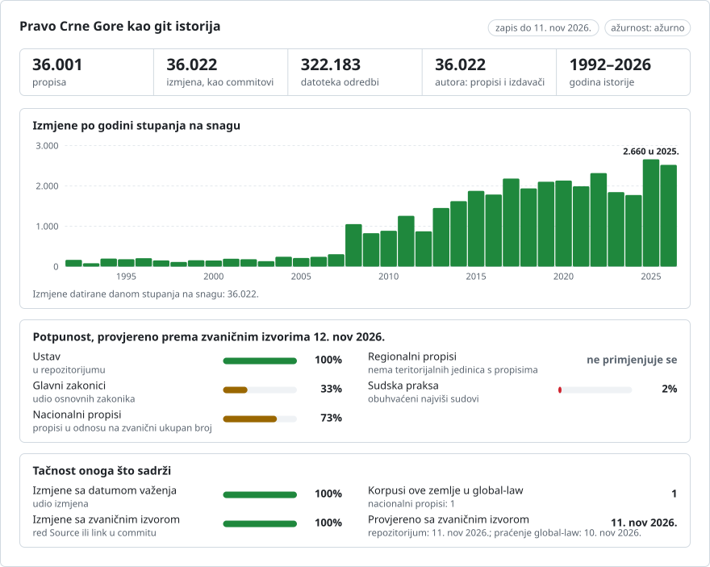

# Crna Gora: istorija propisa u git-u

**Crnogorski** · [English](README.en.md)

<picture>
<source media="(prefers-color-scheme: dark)" srcset="data/cnr/effort-dark.svg">

</picture>

Dio projekta [lexifina/global-law](https://github.com/lexifina/global-law), jedne git istorije prava svih zemalja: ovo je nacionalno pravo Crne Gore, koje global-law čita na putanji `montenegro/national/acts/`.

**Obuhvat**
- Akti koje objavljuje Službeni list Crne Gore i koje njegov pravni informacioni sistem (PIS) označava kao važeće: Ustav sa amandmanima, zakoni, uredbe Vlade, pravilnici, odluke, pravila, naredbe, uputstva, planovi, programi, statuti i međunarodni ugovori, državni i lokalni, svaki iz svog zvaničnog PDF-a.
- Desetine hiljada akata, i sve više kako se preuzimanje iz PIS-a privodi kraju; [ACTS.md](ACTS.md) navodi svaki akt koji repozitorijum sadrži, a [data/held.json](data/held.json) svaki važeći akt koji još ne sadrži, uz razlog.

**Upotreba**
- PIS prikazuje akt onakav kakav je objavljen i navodi akte koji su ga kasnije mijenjali. Ovdje je svaki akt folder sa datotekama članova, pa je ono što je neka odredba glasila, i koji ju je akt napisao, jedan `git log` ili `git blame`.
- Sve se može pretraživati, upoređivati i ponovo koristiti: tekstovi su zvanični, a naš rad je u javnom domenu (CC0).

## Raspored

| Gdje | Šta |
| --- | --- |
| `ustav/` | Ustav (2007), sa amandmanima I-XVI (2013) i XVII-XXI (2026) primijenjenim na odredbe koje zamjenjuju |
| `zakon/`, `uredba/` | zakoni i uredbe Vlade, po godini objavljivanja i PIS identifikatoru; zakoni koji su na snazi od prvog objavljivanja nalaze se na najvišem nivou, pod svojim naslovom (`zakon-o-...`, navedeni u data/paths.json) |
| `odluka/`, `rjesenje/`, `pravilnik/`, `naredba/`, `uputstvo/`, `pravila/`, `poslovnik/`, `statut/`, `program/`, `plan/`, `akt/` | odluke, rješenja, pravilnici, naredbe, uputstva, pravila, poslovnici, statuti, programi, planovi i drugi akti, državni i lokalni |
| `ugovor/` | međunarodni ugovori i drugi međunarodni akti objavljeni u Službenom listu |
| `ukaz/`, `presuda/` | ukazi predsjednika i prevodi presuda Evropskog suda za ljudska prava protiv Crne Gore koje objavljuje Službeni list, a koje PIS ostavlja nerazvrstanim (njihova vrsta utvrđuje se iz naslova) |
| `local/<unit>/<year>/<id>/` | opštinski propisi (Službeni list Crne Gore – Opštinski propisi) dodati od 11. novembra 2026, po opštini koja ih je donijela (utvrđenoj iz potpisa i preambule samog akta); raniji opštinski propisi i dalje su u gornjim folderima po vrsti akta, navedeni u data/paths.json |
| `<act>/clan-NNN.md` · `<act>/README.md` | jedan član po datoteci (jedan stav po redu) · verzije akta i napomene |
| [ACTS.md](ACTS.md) · `data/` · `tools/` | spisak akata · tabele i indeksi · alati navedeni ispod |

## Pitanja kao git komande

| Pitanje | Komanda |
| --- | --- |
| Šta je glasio član 91 Ustava 1. januara 2020? | `python tools/on.py 2020-01-01 ustav clan-091` |
| Koji je amandman napisao svaki stav člana 91? | `git blame ustav/clan-091.md` |
| Svaka izmjena člana, riječ po riječ | `git log -p --word-diff ustav/clan-127.md` |
| Sve što je promijenio jedan amandman | `git log --author="Amandman XX " --stat` |
| Da li je akt ovdje ažuran? | `python tools/freshness.py <act id>` |

Datume čitajte alatima, a ne sa `git rev-list --before`: alati biraju svaku verziju prema njenom zapisu `In-force:`.

**Ili pitajte običnim riječima.** Isti podaci su besplatni i bez gita, naloga ili ključa:

- **[Pitajte Claude o propisima Crne Gore](https://global-law.lexifina.com/v1/try_claude?country=montenegro&q=what%20does%20the%20Labour%20Law%20%28Zakon%20o%20radu%29%20say%20about%20annual%20leave%20%28godi%C5%A1nji%20odmor%29%20today%2C%20and%20how%20has%20its%20%C4%8Dlan%2079%20changed%20since%202020%3F%20Quote%20the%20words%20of%20the%20law%2C%20name%20the%20law%20behind%20each%20change%20with%20the%20day%20it%20took%20effect%2C%20and%20cite%20the%20official%20publisher%27s%20page.)**: jedan klik otvara Claude sa spremnim prvim pitanjem (godišnji odmor u Zakonu o radu i kako se mijenjao).
- **[Pitajte ChatGPT](https://global-law.lexifina.com/v1/try_chatgpt?country=montenegro&q=what%20does%20the%20Labour%20Law%20%28Zakon%20o%20radu%29%20say%20about%20annual%20leave%20%28godi%C5%A1nji%20odmor%29%20today%2C%20and%20how%20has%20its%20%C4%8Dlan%2079%20changed%20since%202020%3F%20Quote%20the%20words%20of%20the%20law%2C%20name%20the%20law%20behind%20each%20change%20with%20the%20day%20it%20took%20effect%2C%20and%20cite%20the%20official%20publisher%27s%20page.)**: isto pitanje u ChatGPT-u.
- **[Pozovite API u pregledaču](https://global-law.lexifina.com/v1/search_law?query=godi%C5%A1nji+odmor&jurisdictions=montenegro)**: pretraga propisa Crne Gore za „godišnji odmor”, odgovor u JSON-u. Bez ključa 5 poziva u minuti; [svi alati](https://global-law.lexifina.com/v1), [ključevi i dokumentacija](https://lexifina.com/api).

Asistenti čitaju podatke preko besplatnog konektora Global law (MCP, `https://global-law.lexifina.com/mcp`); prvi put razgovor daje link kojim se konektor dodaje. U Claude-u izaberite „Always allow” da ne potvrđujete svaki poziv. Pitajte na crnogorskom ili engleskom.

## Izvori

- Pravni informacioni sistem Službenog lista (PIS, [sluzbenilist.me/propisi](https://www.sluzbenilist.me/propisi)): stranica svakog akta navodi broj Službenog lista, dan objavljivanja, dan stupanja na snagu i dan početka primjene, status akta (Važeći / Nevažeći) i akte koji ga mijenjaju; `/propisi/<id>/download` daje njegov PDF, čiji se tekstualni sloj čita. Gdje tekstualni sloj PDF-a nije njegov tekst, akt se čita iz alternativnog teksta, označenog na verziji: iz tekstualnog sloja u kojem su znakovi koje stari font pogrešno preslikava vraćeni na ispravne (Ĉ→Č, ţ→ž, Ċ→đ, ...; svaka ispravljena riječ provjerena je prema čistim tekstovima), ili iz OCR-a (Tesseract) skeniranih stranica, uz prag pouzdanosti prepoznatih riječi.
- Svaka verzija navodi zvaničnu stranicu i PDF iz kojih je pročitana (zapisi `Source:` i `Consolidated:` u njenom commitu i `portal` u [data/acts.json](data/acts.json)).

## Koliko je ažurno

Svaka verzija navodi zvaničnu stranicu iz koje je pročitana, pa se svaki akt može provjeriti prema izvoru.

<!-- freshness-summary -->
Provjereno prema zvaničnim izvorima: 2026-11-11; 100% akata provjereno u posljednjih 7 dana, 100% u posljednjih 30 ([data/freshness.json](data/freshness.json)).
<!-- /freshness-summary -->

`python tools/freshness.py <act>` daje status akta, njegovu posljednju provjeru i zvanični link. Program za osvježavanje ponovo čita PIS stranicu svakog akta u okviru njegovog praga (7 dana za Ustav, zakone i uredbe Vlade, 30 za ostale) i dodaje nove akte kako ih Službeni list objavljuje; [data/status.json](data/status.json), koji svako pokretanje iznova ispisuje, pokazuje da li ažuriranja rade i koji su zvanični izvori odgovorili. Statusi i polja objašnjeni su u [data/freshness.json](data/freshness.json). Važeći akti koje repozitorijum ne sadrži nalaze se u [data/held.json](data/held.json), uz razlog; akti koji su objavljeni, ali još nijesu stupili na snagu, nalaze se u [data/pending.json](data/pending.json) i dodaju se na dan stupanja na snagu.

## Datumi, autori i ograničenja

- Svaki commit nosi datum u podne, po vremenu Europe/Podgorica, na dan kada je izmjena stupila na snagu („Datum stupanja na snagu“ iz PIS-a, provjeren prema završnom članu samog akta); autor je akt koji ju je donio, a committer Lexifina. Poseban dan početka primjene („Datum početka primjene“) naveden je na verziji.
- Pojedinačni i programski akti (imenovanja, odluke, zaključci, programi, planovi, ukazi predsjednika, presude Evropskog suda za ljudska prava) čiji tekst ne navodi dan stupanja na snagu, a za koje ga ni PIS ne daje, datiraju se danom objavljivanja u Službenom listu; napomena svake takve verzije to navodi. Zakoni, uredbe, pravilnici, statuti i međunarodni ugovori bez dana stupanja na snagu i dalje se ne unose (data/held.json).
- PIS ne objavljuje prečišćene tekstove. Akt se ovdje nalazi onakav kakav je objavljen; gdje PIS navodi kasnije akte koji ga mijenjaju, status akta u data/acts.json je `amended, not consolidated`, a `amended_by` navodi te akte, sa njihovim zvaničnim linkovima. Samo se amandmani na Ustav primjenjuju na njegov tekst.
- Gdje PIS ne navodi nijedan akt koji ga mijenja, ali naslovi kasnijih akata navode da se taj akt mijenja ili ispravlja, a nijedan drugi akt u PIS-u nema njegov naslov, i on je označen kao `amended, not consolidated`, sa tim aktima kao `amended_by`; akti sa istim naslovom se ne unose.
- Mjerodavan je samo Službeni list Crne Gore. Predsjednikov ukaz o proglašenju, odštampan iznad zakona, kao i potpisi, izostavljeni su; prilog odštampan poslije potpisa čini jednu cjelinu.
- Ustav iz 2007. objavljen je ćirilicom, a njegovi amandmani latinicom; svaki red zadržava pismo teksta iz kojeg potiču njegove riječi. Ništa nije transliterisano.
- Svaka verzija se na dan stupanja na snagu čita iz git-a i mora se podudarati sa izvorom; rezultati su u `REPRODUCE.md`.

## Licenca

Tekstovi su zvanični tekstovi Crne Gore, koje Zakon o autorskom i srodnim pravima isključuje iz autorskopravne zaštite, preuzeti iz Službenog lista Crne Gore (www.sluzbenilist.me). Raspored, tabele, poruke commitova i alati koje je izradila Lexifina nalaze se u javnom domenu (CC0 1.0), kako je utvrđeno u `LICENSE`. Ovaj repozitorijum nije pravni savjet niti službena publikacija.

Ovo je prevod engleske verzije ([README.en.md](README.en.md)); ako se razlikuju, važi engleska verzija.

## Više

Iz repozitorijuma [lexifina/global-law](https://github.com/lexifina/global-law) (na engleskom):

- [FEATURES.md](https://github.com/lexifina/global-law/blob/main/FEATURES.md): sve funkcije i šta svaki korpus mora da podržava (`git blame`, `law.py`, MCP alati)
- [FAQ.md](https://github.com/lexifina/global-law/blob/main/FAQ.md): pitanja i odgovori · [CONTRIBUTING.md](https://github.com/lexifina/global-law/blob/main/CONTRIBUTING.md): predlaganje izmjena · [MCP.md](https://github.com/lexifina/global-law/blob/main/MCP.md): MCP server · [REPRODUCE.md](https://github.com/lexifina/global-law/blob/main/REPRODUCE.md): kako je napravljen · [CHANGELOG.md](https://github.com/lexifina/global-law/blob/main/CHANGELOG.md)
- [FRESHNESS.md](https://github.com/lexifina/global-law/blob/main/FRESHNESS.md): koliko je ažuran svaki korpus · [Praćenje](https://github.com/lexifina/global-law/tree/main/monitoring): da li ažuriranja rade · [WATCHING.md](https://github.com/lexifina/global-law/blob/main/WATCHING.md): kako se svaki zvanični izvor prati zbog izmjena
- [performance/](https://github.com/lexifina/global-law/tree/main/performance): koliko su alati brzi, izmjereno
- [visualisations/](https://github.com/lexifina/global-law/tree/main/visualisations): grafikoni i veze kroz pravo cijelog svijeta
- [Ranjivosti](https://github.com/lexifina/global-law/tree/main/vulnerabilities): greške u propisima onako kako su objavljeni
