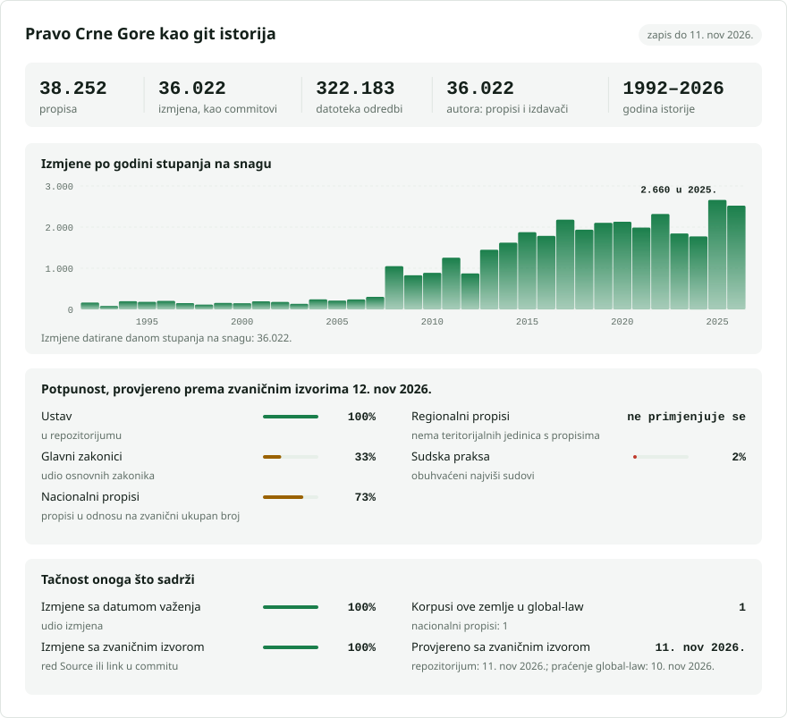

# Crna Gora: istorija propisa u git-u

**Crnogorski** · **[Or read it in English](README.en.md)**

<picture>
<source media="(prefers-color-scheme: dark)" srcset="data/cnr/effort-dark.svg">

</picture>

Pravo Crne Gore kao git istorija: jedna datoteka po članu, jedan commit po verziji na dan kada je stupila na snagu, a autor svakog commita je akt koji ju je donio. Službeni list ne objavljuje prečišćene tekstove, pa je svaki akt ovdje onakav kakav je objavljen, a kasnije verzije ima samo Ustav: njegovi amandmani I-XXI primijenjeni su na članove koje zamjenjuju. `git blame` pokazuje amandman koji stoji iza svakog reda Ustava; `git log` navodi svaku izmjenu člana; izborom datuma dobija se tekst koji je tog dana bio na snazi.

Dio projekta [lexifina/global-law](https://github.com/lexifina/global-law), jedne git istorije prava svih zemalja: ovo je nacionalno pravo Crne Gore, koje global-law čita na putanji `montenegro/national/acts/`.

**Šta sadrži sada:** Ustav i 36.000 važećih akata iz pravnog informacionog sistema Službenog lista (PIS), državnih i opštinskih, svaki onakav kakav je objavljen: 1.122 zakona, 1.094 uredbe Vlade, 3.582 pravilnika, 27.535 odluka i rješenja, 142 međunarodna ugovora i 2.525 drugih akata (naredbe, uputstva, pravila, poslovnici, statuti, programi, planovi); od toga je 4.301 akt o izmjenama i dopunama. [`ACTS.md`](ACTS.md) navodi sve akte, po vrsti; [`data/held.json`](data/held.json) navodi važeće akte koji ovdje još nijesu, svaki uz razlog.

Svaki akt je u `<vrsta>/<godina>/<PIS id>/`, prema godini objavljivanja (`zakon/2019/312153/` je Zakon o radu, „Službeni list Crne Gore”, broj 74/2019); odluke, kojih ima više od hiljadu godišnje, nalaze se i pod mjesecom objavljivanja (`odluka/<godina>/<mjesec>/<PIS id>/`). Ustav je u [`ustav/`](ustav/). `data/paths.json` povezuje id svakog akta sa njegovim folderom.

Tekst je na crnogorskom, onako kako ga objavljuje Službeni list: Ustav iz 2007. ćirilicom, njegovi amandmani i gotovo svi drugi akti latinicom; ništa nije transliterisano. Prevod na engleski nije dio ovog repozitorijuma.

## Pitanja kao git komande

| Pitanje | Komanda |
| --- | --- |
| Svaka izmjena člana 91 Ustava | `git log -p --word-diff -- ustav/clan-091.md` |
| Koji je amandman napisao svaki red člana 91? | `git blame ustav/clan-091.md` |
| Svaka verzija Ustava, sa danom kada je stupila na snagu | `git log --format="%h %(trailers:key=In-force,valueonly,separator=) %an" -- ustav ':!ustav/README.md'` |
| Član 91 kako je glasio 1. januara 2020. | `python tools/on.py 2020-01-01 ustav clan-091` |

Bilo koji drugi akt na neki dan: `python tools/on.py 2025-06-01 zakon/2019/312153`.

**Izvan git-a** ove podatke takođe objavljujemo javno i besplatno:

- **[Pitajte Claude o propisima Crne Gore](https://global-law.lexifina.com/v1/try_claude?country=montenegro)**: otvara Claude sa spremnim prvim pitanjem.
- **[Pitajte ChatGPT](https://global-law.lexifina.com/v1/try_chatgpt?country=montenegro)**: isto pitanje u ChatGPT-u.
- **[Pretražite propise Crne Gore na našem sajtu](https://lexifina.com/law?country=montenegro&q=godi%C5%A1nji+odmor)**: pretraga za „godišnji odmor”, sa tekstom svake odredbe i njenim verzijama, bez naloga.
- **[REST API za programere](https://global-law.lexifina.com/v1/search_law?query=godi%C5%A1nji+odmor&jurisdiction=montenegro)**: ista pretraga kao JSON, bez ključa. Dokumentacija je [ovdje](https://lexifina.com/api/global-law).

Oba asistenta čitaju podatke preko besplatnog konektora Global law (MCP, `https://global-law.lexifina.com/mcp`); prvi put razgovor daje link kojim se konektor dodaje. Pitajte na crnogorskom ili na engleskom.

**Lako ga pokrenite sami.** Dovoljni su git i Python, a alati rade na vašem računaru:

```sh
git clone --depth 1 https://github.com/lexifina/global-law && cd global-law
python3 tools/countries.py add montenegro/national/acts
python3 tools/law.py show 2026-01-01 montenegro/national/acts/ustav/clan-091.md
```

Otvoren u Claude Code-u, Cursoru, VS Code-u ili Codexu, klon pokreće i lokalni MCP server sa istim alatima ([MCP.md](https://github.com/lexifina/global-law/blob/main/MCP.md)).

## Datumi

Svaki commit nosi datum u podne po podgoričkom vremenu (Europe/Podgorica), na dan kada je verzija stupila na snagu, a taj dan stoji i u njegovom `In-force:` traileru; dani donošenja i objavljivanja akta su traileri `Enacted:` i `Published:`:

- dan stupanja na snagu koji daje PIS („Datum stupanja na snagu”), provjeren prema odredbi samog akta o stupanju na snagu;
- gdje ga PIS ne daje, dan koji navodi odredba samog akta o stupanju na snagu („osmog dana od dana objavljivanja”), računat od dana objavljivanja i naveden u poruci commita;
- kasniji dan početka primjene („Datum početka primjene”) naveden je u poruci commita i ne mijenja datum;
- Ustav je stupio na snagu proglašenjem, 22. oktobra 2007, a njegovi amandmani svojim proglašenjem (I-XVI 31. jula 2013, XVII-XXI 24. avgusta 2026).

Svaki akt se pripisuje samom sebi, sa brojem Službenog lista (`Zakon o radu (Službeni list Crne Gore, broj 74/2019)`); svaka izmjena Ustava pripisuje se njenom amandmanu (`Amandman IV`). Committer je Lexifina.

## Koliko je ažurno

- `python tools/freshness.py <akt>`: status akta, njegova posljednja provjera prema njegovoj PIS stranici i zvanični link; Ustav, zakoni i uredbe Vlade provjeravaju se svakih 7 dana, ostali akti svakih 30
- [data/status.json](data/status.json): da li ažuriranja rade i koji su zvanični izvori odgovorili
- [data/pending.json](data/pending.json): akti koji su objavljeni, ali još nijesu stupili na snagu; svaki se dodaje na dan stupanja na snagu

## Kako se provjerava

- `tools/build/check_repo.py` čita svaku verziju iz git-a na dan kada je stupila na snagu, i na dan prije toga, i poredi je, datoteku po datoteku, sa korpusom iz kojeg je napravljena; provjerava i trailere svakog commita, kao i to da na `main` nema merge commitova, datuma koji idu unazad ni ičega datiranog u budućnosti.
- `tools/build/append.py` dodaje nove akte na vrh i ništa ne prepravlja: tekst na `main` prvo mora biti jednak korpusu za svaki akt koji sadrži, a svaka razlika zaustavlja pokretanje radi označene ispravke o kojoj se odlučuje ručno. Isti vrh i isti korpus uvijek daju iste hash vrijednosti commitova.
- Amandmani na Ustav primjenjuju se kodom na odredbu koju svaki amandman sam navodi, iz tabele operacija provjerene prema riječima Službenog lista; tekst propisa se ne mijenja.
- Odluke donesene ručno navedene su u `README.md` svakog akta; kako je repozitorijum napravljen, opisano je u [`REPRODUCE.md`](REPRODUCE.md).
- [vulnerabilities/](vulnerabilities/): moguće greške u propisima Crne Gore, koje su pronašli detektori global-law i koje su ručno provjerene.

## Šta ne prikazuje

- **Akte sa kasnijim izmjenama.** Osim Ustava, akt koji je kasnije mijenjan nalazi se ovdje onakav kakav je objavljen: 3.188 akata označeno je kao `amended, not consolidated` u [data/acts.json](data/acts.json), a akti koji ih mijenjaju navedeni su u `amended_by`; te izmjene nijesu primijenjene na njihov tekst.
- **41.636 važećih akata koji još nijesu ovdje** ([data/held.json](data/held.json)): 21.209 akata čiji se dan stupanja na snagu ne može pročitati, 8.567 izmijenjenih akata čiji objavljeni tekst još nije pročitan, 3.997 akata vrsta koje još nijesu obrađene i 7.863 akta čiji se tekst ili datumi ne čitaju čisto (skenirane stranice, pogrešni glifovi, članovi van redosljeda, dan koji je u suprotnosti sa aktom).
- **Akte koji više nijesu na snazi.** Čitaju se samo akti koje PIS označava kao važeće; ukinuti akti i raniji tekstovi nijesu ovdje.
- **Sudsku praksu, predloge i nacrte propisa**: nijesu dio ovog repozitorijuma.

## Izvori

| Izvor | Vrsta | Ranije verzije | Napomene |
| --- | --- | --- | --- |
| [Pravni informacioni sistem Službenog lista Crne Gore](https://www.sluzbenilist.me/propisi) (PIS) | Registar akata Službenog lista | ne: svaki akt onakav kakav je objavljen, uz navedene akte koji ga mijenjaju | Stranica svakog akta (broj, dan objavljivanja, stupanja na snagu i početka primjene, status) i njegov zvanični PDF, čiji se tekstualni sloj čita; mjerodavan je samo Službeni list |

## Licenca

Vidi [`LICENSE`](LICENSE). Zakoni, drugi propisi i službeni akti nijesu zaštićeni autorskim pravom prema Zakonu o autorskom i srodnim pravima; raspored, poruke commitova, tabele i alati koje je izradila Lexifina posvećeni su javnom domenu pod licencom CC0 1.0.

Nijedan AI model nije pisao, prevodio niti ispravljao tekst propisa; skripte je napisao AI model, koji je i prepisao uputstvo svakog amandmana na Ustav u tabelu operacija koju parser provjerava (vidi [`REPRODUCE.md`](REPRODUCE.md)).

Ovo je prevod engleske verzije ([README.en.md](README.en.md)); ako se razlikuju, važi engleska verzija.

## Vizualizacije

[visualisations/](visualisations/): mjesto za grafikone o crnogorskom pravu, nacrtane iz ovog repozitorijuma; još nijesu nacrtani.

## Više

Iz repozitorijuma [lexifina/global-law](https://github.com/lexifina/global-law) (na engleskom):

- [FEATURES.md](https://github.com/lexifina/global-law/blob/main/FEATURES.md): sve funkcije i šta svaki korpus mora da podržava (`git blame`, `law.py`, MCP alati)
- [FAQ.md](https://github.com/lexifina/global-law/blob/main/FAQ.md): pitanja i odgovori · [CONTRIBUTING.md](https://github.com/lexifina/global-law/blob/main/CONTRIBUTING.md): predlaganje izmjena · [MCP.md](https://github.com/lexifina/global-law/blob/main/MCP.md): MCP server · [REPRODUCE.md](https://github.com/lexifina/global-law/blob/main/REPRODUCE.md): kako je napravljen · [CHANGELOG.md](https://github.com/lexifina/global-law/blob/main/CHANGELOG.md)
- [FRESHNESS.md](https://github.com/lexifina/global-law/blob/main/FRESHNESS.md): koliko je ažuran svaki korpus · [Praćenje](https://github.com/lexifina/global-law/tree/main/monitoring): da li ažuriranja rade · [WATCHING.md](https://github.com/lexifina/global-law/blob/main/WATCHING.md): kako se svaki zvanični izvor prati zbog izmjena
- [performance/](https://github.com/lexifina/global-law/tree/main/performance): koliko su alati brzi, izmjereno
- [visualisations/](https://github.com/lexifina/global-law/tree/main/visualisations): grafikoni i veze kroz pravo cijelog svijeta
- [Ranjivosti](https://github.com/lexifina/global-law/tree/main/vulnerabilities): greške u propisima onako kako su objavljeni
