# Montenegrin law in 20 charts

[Crnogorski](README.md)

Charts on every country's law, from the whole of global-law: [global-law visualisations/](https://github.com/lexifina/global-law/tree/main/visualisations). These are the charts on Montenegro alone.

Twenty charts on Montenegrin law, drawn only from the data in this repository: the acts in force from the legal information system of the Službeni list Crne Gore (PIS), from laws to municipal decisions, with their texts and preambles, the Constitution and its amendments, the decrees on ambassadors and the git history.

Open [`crnogorsko-pravo-u-20-grafikona.html`](crnogorsko-pravo-u-20-grafikona.html) in a browser. The page is one file with all its data inside; it loads only the d3 and topojson libraries, the world map of chart 15 and its fonts from the web. The controls at the top right switch the language (Montenegrin or English) and the theme (light or dark). Each chart names its data path in the repository, its record count and its limits, and has a table of every number under it. Hover over a mark for the exact values.

The charts are descriptive: they show what the sources record, not why.

## The charts

### I. The Službeni list and the acts in force

#### 1. What is in force today

The acts in force by year of publication and kind: 93% were published in 2007 or later.

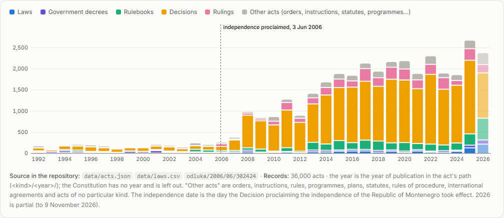

#### 2. Who makes the acts in force

The maker named in each act's preamble, by period: municipalities made 59% of the acts in force.

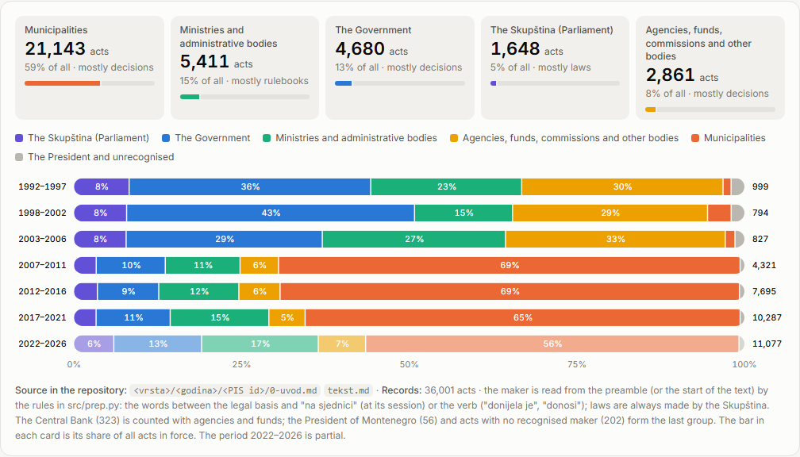

#### 3. Cyrillic and Latin

The script of each act's text by year of publication, for state bodies and for municipalities.

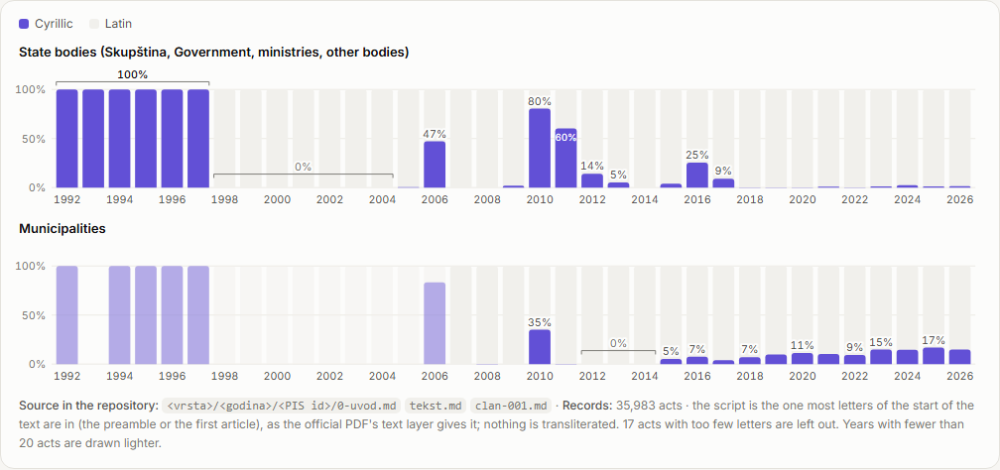

#### 4. The eighth day

How many days pass from publication to entry into force, by kind of act: 79% of laws take effect on the eighth day.

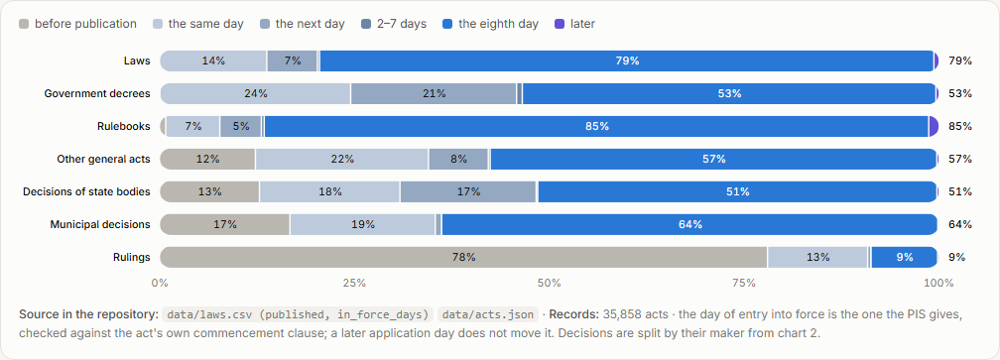

### II. The Skupština and the laws

#### 5. Convocations and sessions

Every law since 2009 by the month it was voted, its convocation and its session, regular or extraordinary.

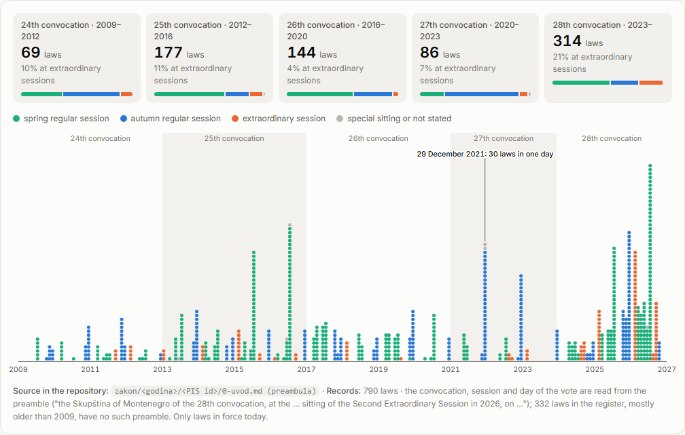

#### 6. Passed twice

The laws the Skupština voted again after they were returned for a new decision, and the days between the two votes.

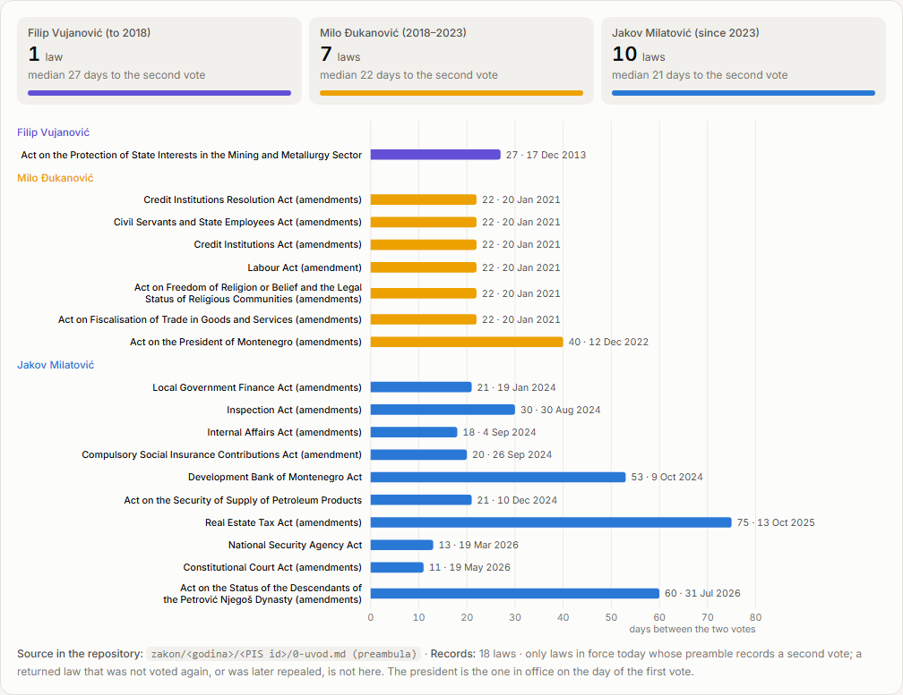

#### 7. Laws by area

The laws in force by area and period of publication, and how many of them amend or supplement an earlier law.

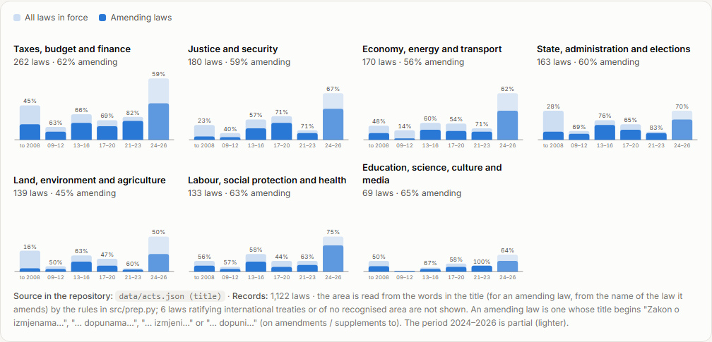

#### 8. The most-amended laws

Amending laws by year for the 20 most-amended laws.

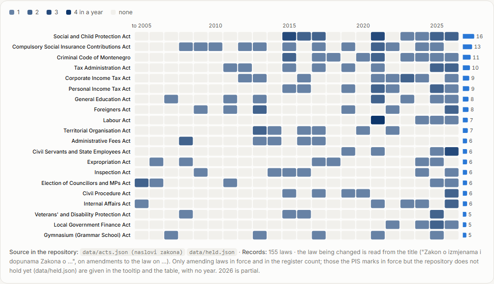

### III. Bylaws, the European Union and the legal basis

#### 9. EU acts in the text

Laws, decrees and rulebooks whose text cites an EU directive, regulation or other act, by year.

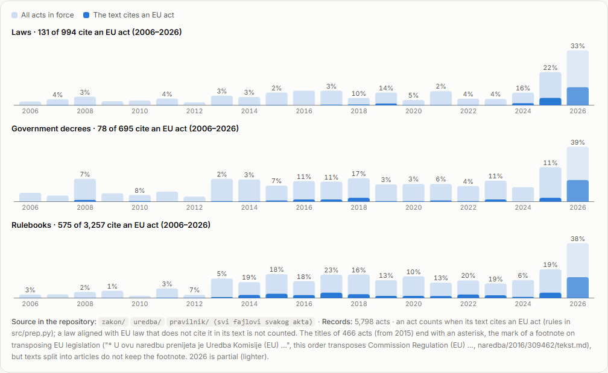

#### 10. On which law

The laws that are the legal basis of the most rulebooks, decrees, orders and instructions.

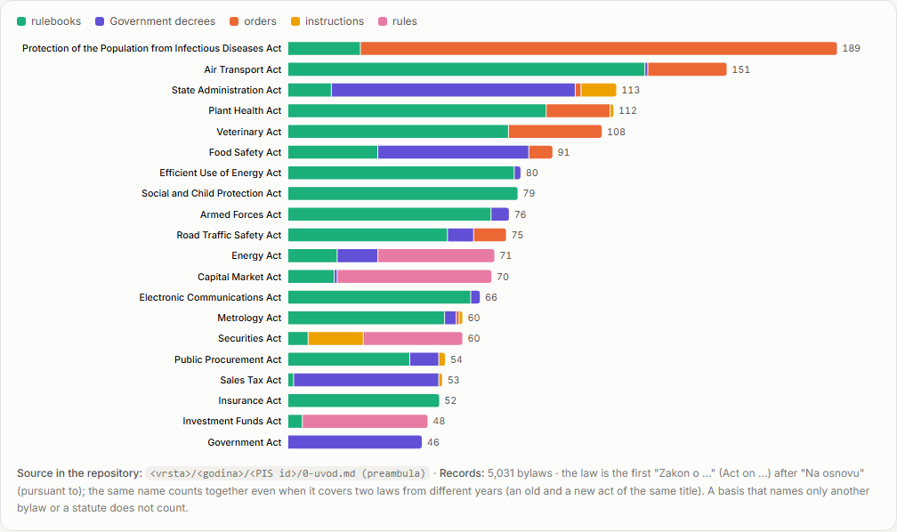

#### 11. An older legal basis

The oldest gazette an act's legal basis names, from the Gazette of the SFRY to the Gazette of Montenegro.

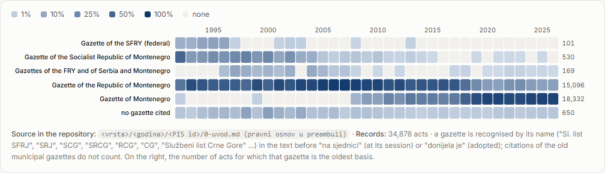

#### 12. Rulebooks by ministry

The rulebooks in force by ministry area and period of publication: 514 from 2026.

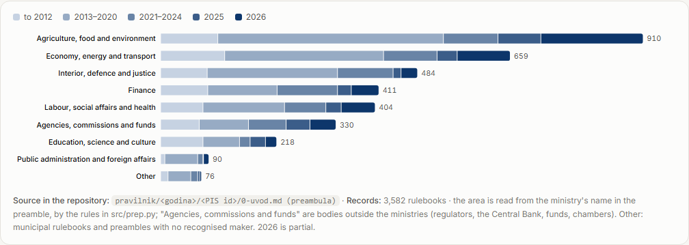

#### 13. The pandemic in the Službeni list

The orders and decisions on the coronavirus the PIS marks in force, by month of publication.

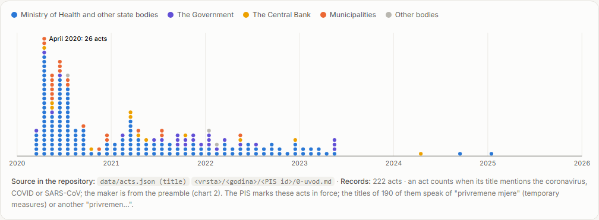

### IV. The Constitution, the state and money

#### 14. The Constitution

Every article of the 2007 Constitution, and the amendments of 2013 and 2026 that changed it.

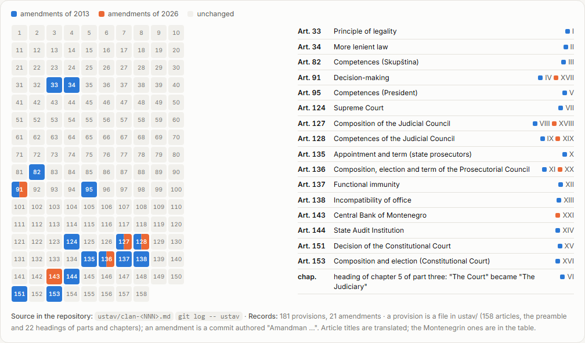

#### 15. Ambassadors by decree

Decrees appointing and recalling ambassadors, on a map and by year.

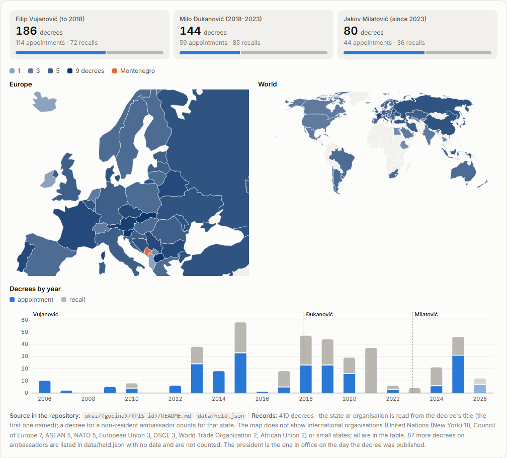

#### 16. Dinar, mark, euro

The currency of sums of money in the acts in force published from 1992 to 2008.

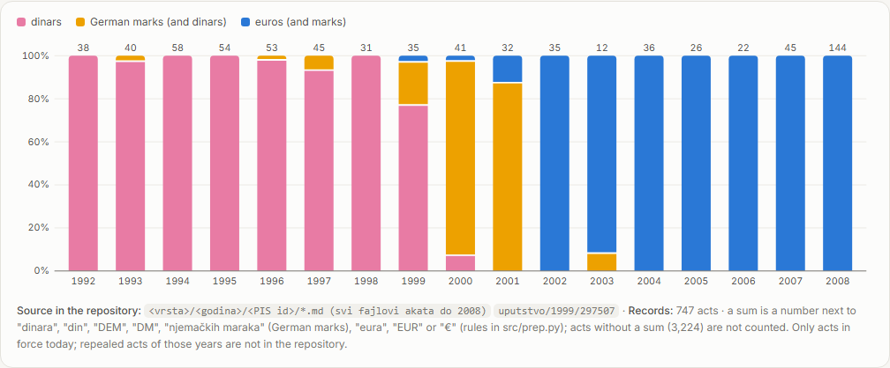

#### 17. Pension adjustments

Every pension adjustment decision in force, from the 1993 hyperinflation to three adjustments a year.

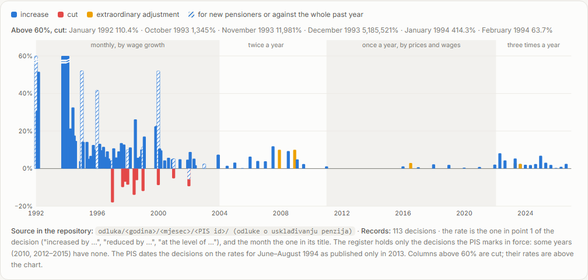

### V. Municipalities

#### 18. Municipalities

The acts in force of the 25 municipalities, on a tile map and in order.

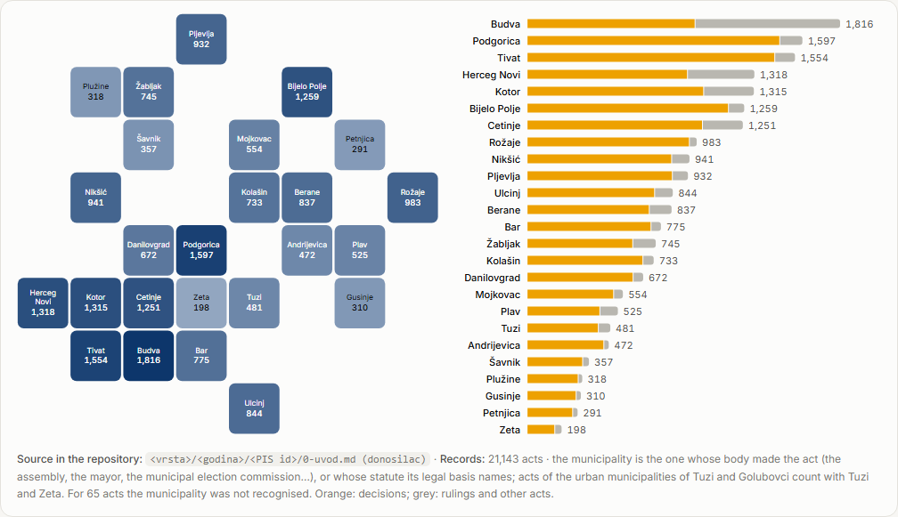

#### 19. Cyrillic by municipality

The share of acts in Cyrillic in each municipality.

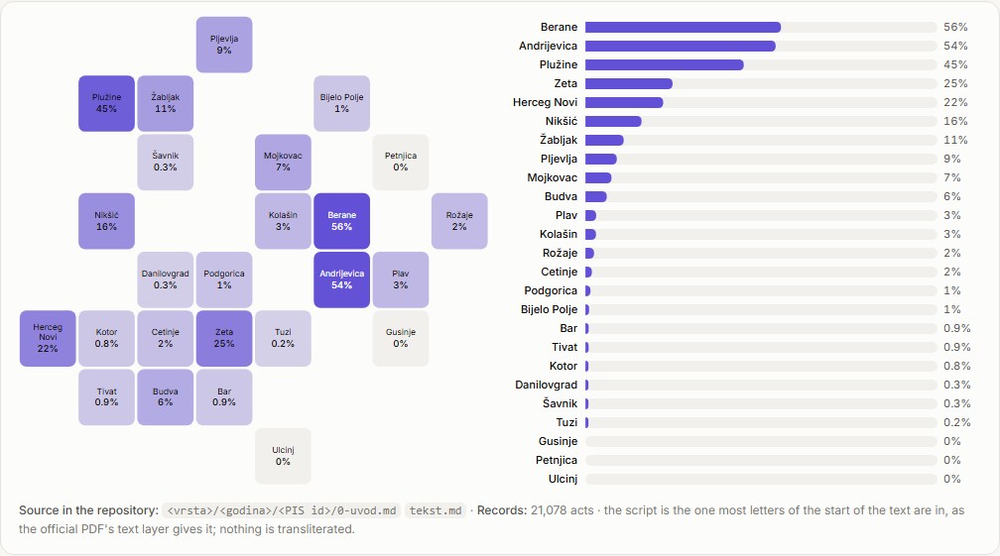

#### 20. What municipalities decide

Municipal acts by topic and year of publication.

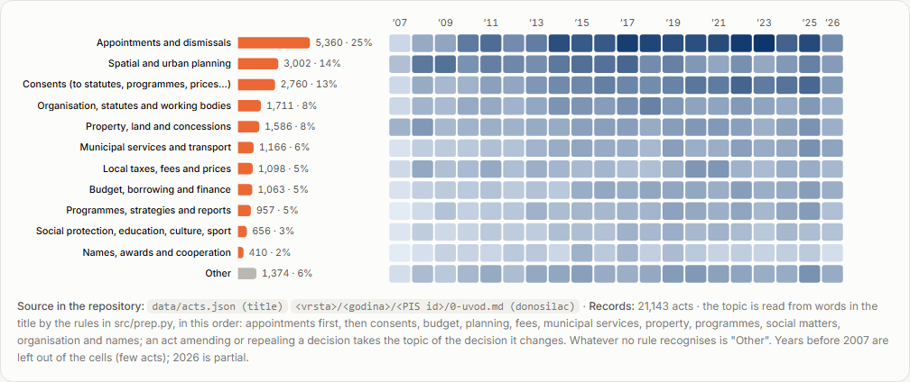

## Data

As of commit `3e92fd62aa` (data to 11 November 2026).

| Dataset | Where in the repository | Records | Coverage |
| --- | --- | ---: | --- |
| Register of acts in force | [`data/acts.json`](../data/acts.json), `<kind>/<year>/<PIS id>/` | 36,001 acts | acts the PIS marks in force, published 1992–2026, each as published |
| Dates | [`data/laws.csv`](../data/laws.csv) | 36,001 acts | for every act in the register: days of enactment, publication and entry into force, and the Gazette issue |
| Texts of the acts | `<kind>/<year>/<PIS id>/*.md` | the start of 36,000 texts; the whole text of 8,679 | whole text: all laws, decrees and rulebooks, all acts published up to 2008, and the pension adjustment decisions |
| The Constitution and its amendments | [`ustav/`](../ustav/), git history | 181 provisions (158 articles, the preamble and 22 headings), 21 amendments | 2007, 2013 and 2026 |
| Decrees on ambassadors | [`ukaz/`](../ukaz/) | 410 decrees | 2006–2026, metadata only |
| Acts in force held back | [`data/held.json`](../data/held.json) | 41,636 acts | a reason for each; the charts do not count them |
| Git history | branch `main` | 41,614 commits | the date of a commit is the day the version took effect (`In-force:`) |

## Limits

- **Acts in force only.** The PIS gives the repository only the acts it marks in force; repealed acts and earlier texts are not here. So the charts by year or month show what of that time is still in force, not how much was published then.
- **Text as published.** The Službeni list publishes no consolidated texts, so amendments are separate acts (chart 8); only the Constitution is consolidated in the git history (chart 14). Footnotes and signatures are not in the texts: the asterisk in a title, the mark of transposed EU legislation, is kept, the footnote itself is not (chart 9).
- **Categories are read from the texts.** The maker (charts 2, 18, 19 and 20), the script (3 and 19), the convocation and session (5 and 6), a law's area (7), the law an amendment changes (8), EU citations (9), the legal basis (10 and 11), a ministry's area (12), the acts on the coronavirus (13), an ambassador's state (15), the currency (16), the pension adjustment percentage (17) and a municipal act's topic (20) come from the rules in `src/prep.py`. Whatever no rule recognises is shown as "Other" or given in the note.
- **A preamble naming the convocation and the session** is found in laws only from 2009 (charts 5 and 6).
- **41,636 acts in force are not yet in the repository** (`data/held.json`); the charts do not count them, except in the tooltips of chart 8 and the note of chart 15.
- **The partial year** (2026), and the periods that include it, are drawn lighter and labelled as such.

## Rebuilding

```sh
python visualisations/src/make.py                     # git -> src/.build/ -> crnogorsko-pravo-u-20-grafikona.html
python visualisations/src/make.py --ref 3e92fd62aa    # this very page
node visualisations/src/stills.cjs                    # images for these READMEs (needs Playwright; PLAYWRIGHT=<path> if not global)
```

`make.py` reads everything from git objects, so it also works in a blobless or `--no-checkout` clone: it fetches, in batches, the blobs the charts read when they are missing (the tables in `data/`, the start of every act's text, the whole text of laws, decrees and rulebooks and of the acts up to 2008, the Constitution and the decrees) and nothing else. It reads `origin/main` (or `HEAD`) by default; `--ref` picks another branch or commit. It writes nothing into the repository except the page and the `src/.build/` folder (which git ignores).

| File | What it does |
| --- | --- |
| `src/make.py` | fetches the blobs it needs, extracts the tables, the tree and the history into `src/.build/`, then runs `prep.py` and `build.py` |
| `src/prep.py` | reads the tables and the texts of the acts and computes every number for the 20 charts and the data profile into `src/.build/data.json`; every classification rule is here |
| `src/page.tpl.html` | the page: text in both languages, the charts (d3), the tables |
| `src/build.py` | puts `data.json` into the template and writes the page |
| `src/stills.cjs` | draws each chart as a PNG into `stills/cnr/` and `stills/en/` |
