# Crnogorsko pravo u 20 grafikona

[English](README.en.md)

Grafikoni o pravu svih zemalja, iz cijelog global-law-a: [global-law visualisations/](https://github.com/lexifina/global-law/tree/main/visualisations). Ovdje su samo grafikoni o Crnoj Gori.

Dvadeset grafikona o crnogorskom pravu nacrtanih samo iz podataka ovog repozitorijuma: važeći akti iz pravnog informacionog sistema Službenog lista Crne Gore (PIS), od zakona do opštinskih odluka, sa svojim tekstovima i preambulama, Ustav i amandmani na Ustav, ukazi o ambasadorima i istorija gita.

Otvorite [`crnogorsko-pravo-u-20-grafikona.html`](crnogorsko-pravo-u-20-grafikona.html) u pregledaču. Stranica je jedna datoteka sa svim podacima; s interneta učitava samo biblioteke d3 i topojson, kartu svijeta za grafikon 15 i fontove. Gore desno se bira jezik (crnogorski ili engleski) i tema (svijetla ili tamna). Uz svaki grafikon stoji putanja do podataka u repozitorijumu, broj zapisa i ograničenja, a ispod njega je tabela sa svim brojevima. Kada se miš zadrži na oznaci, vide se tačne vrijednosti.

Grafikoni su opisni: pokazuju šta izvori bilježe, ne zašto.

## Grafikoni

### I. Službeni list i važeći propisi

#### 1. Šta je danas na snazi

Važeći akti po godini objavljivanja i vrsti: 93 % objavljeno je 2007. ili kasnije.

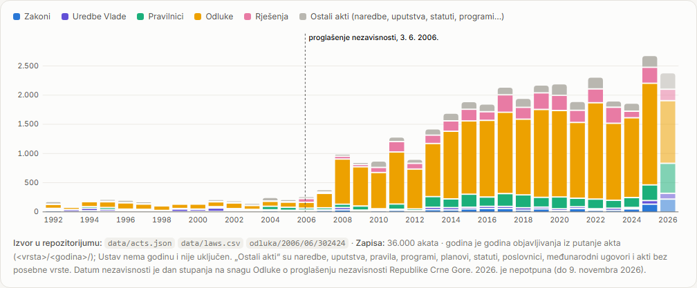

#### 2. Ko donosi propise

Donosilac iz preambule svakog akta, po periodima: opštine su donijele 59 % važećih akata.

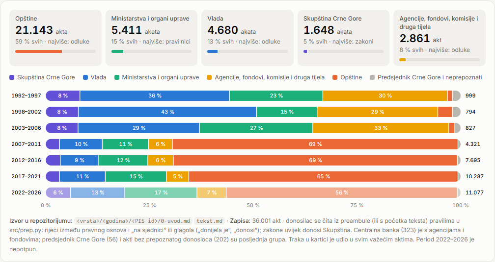

#### 3. Ćirilica i latinica

Pismo teksta svakog akta po godini objavljivanja, posebno za državne organe i za opštine.

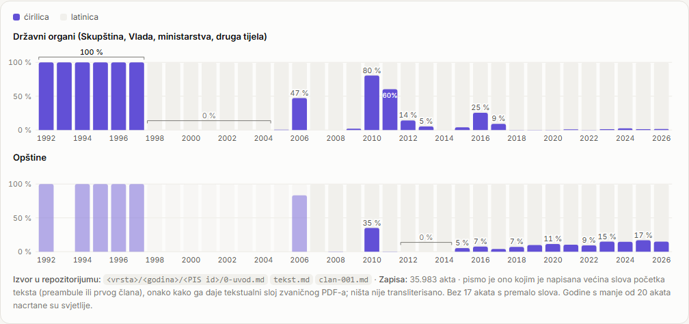

#### 4. Osmi dan

Koliko dana prođe od objavljivanja do stupanja na snagu, po vrsti akta: 79 % zakona stupa na snagu osmog dana.

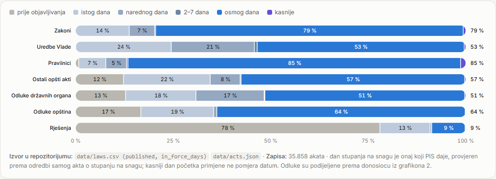

### II. Skupština i zakoni

#### 5. Sazivi i zasijedanja

Svaki zakon od 2009. po mjesecu izglasavanja, sazivu i zasijedanju, redovnom ili vanrednom.

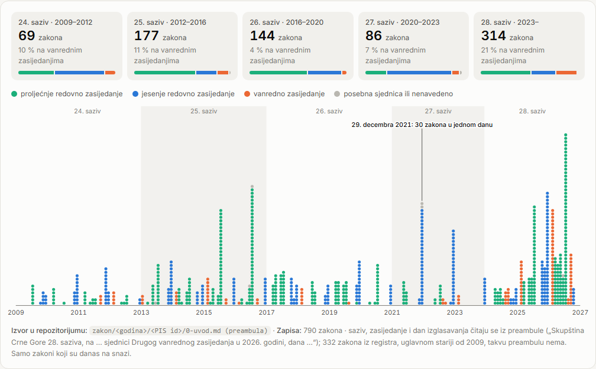

#### 6. Dva puta izglasani

Zakoni koje je Skupština izglasala ponovo, poslije vraćanja na ponovno odlučivanje, i dani između dva glasanja.

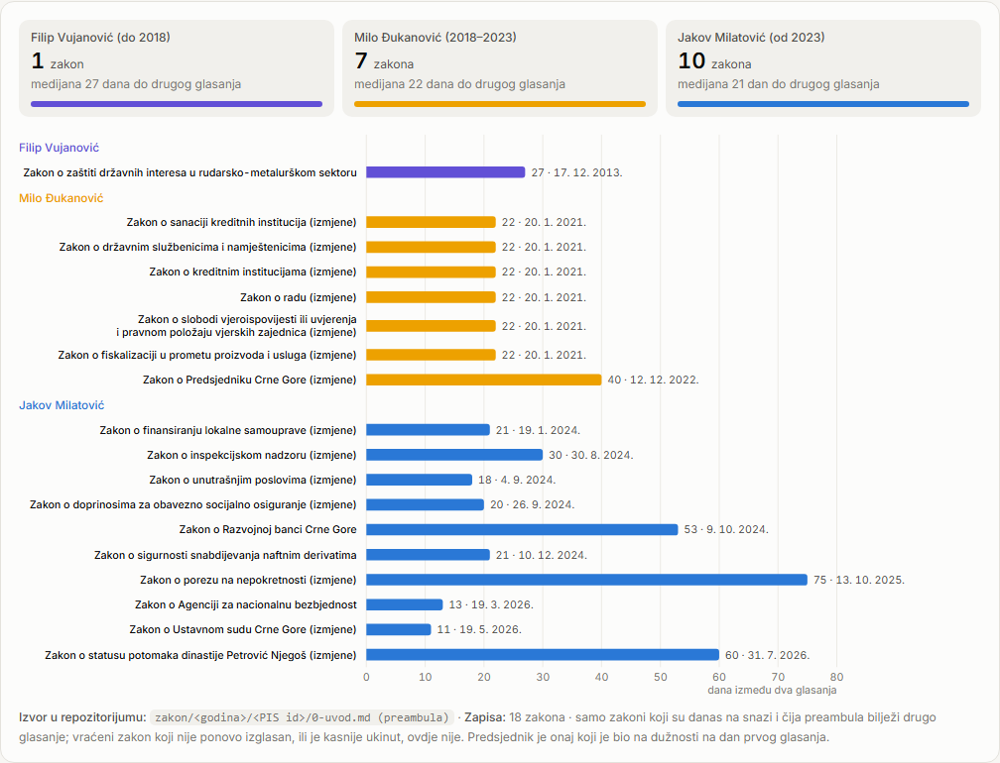

#### 7. Zakoni po oblastima

Važeći zakoni po oblasti i periodu objavljivanja, i koliko od njih mijenja ili dopunjuje neki raniji zakon.

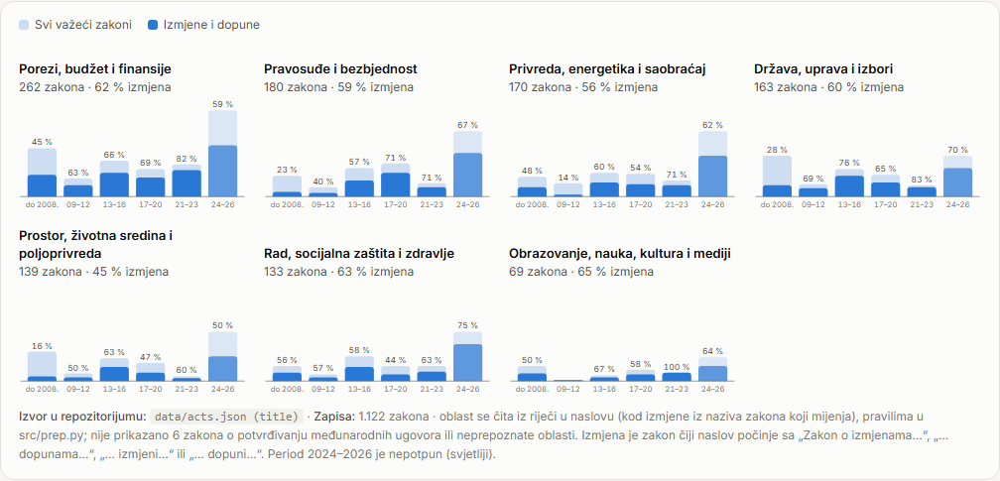

#### 8. Najčešće mijenjani zakoni

Zakoni o izmjenama i dopunama po godini, za 20 najčešće mijenjanih zakona.

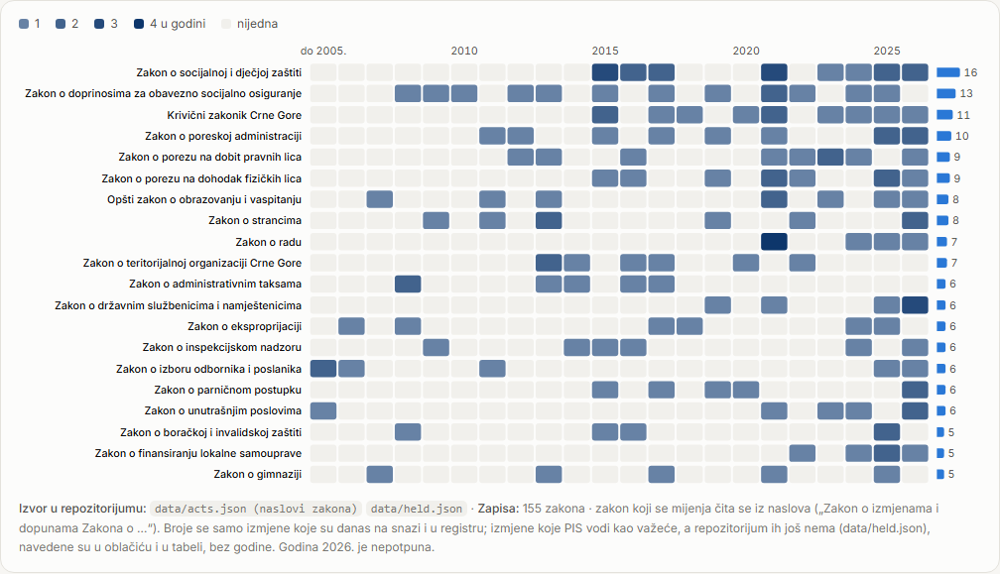

### III. Podzakonski akti, Evropska unija i pravni osnov

#### 9. Akti Evropske unije u tekstu

Zakoni, uredbe i pravilnici čiji tekst navodi direktivu, uredbu ili drugi akt EU, po godini.

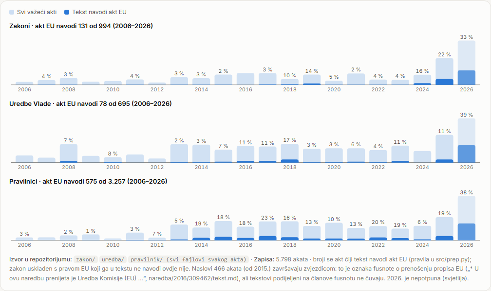

#### 10. Na osnovu kojeg zakona

Zakoni koji su pravni osnov za najviše pravilnika, uredbi, naredbi i uputstava.

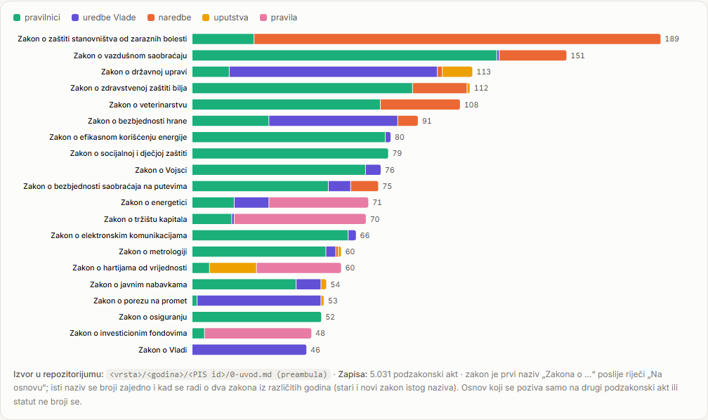

#### 11. Stari pravni osnov

Najstariji službeni list koji navodi pravni osnov akta, od Službenog lista SFRJ do Službenog lista Crne Gore.

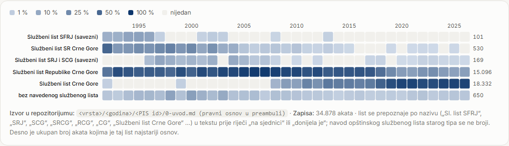

#### 12. Pravilnici po resorima

Važeći pravilnici po oblasti ministarstva i periodu objavljivanja: 514 iz 2026.

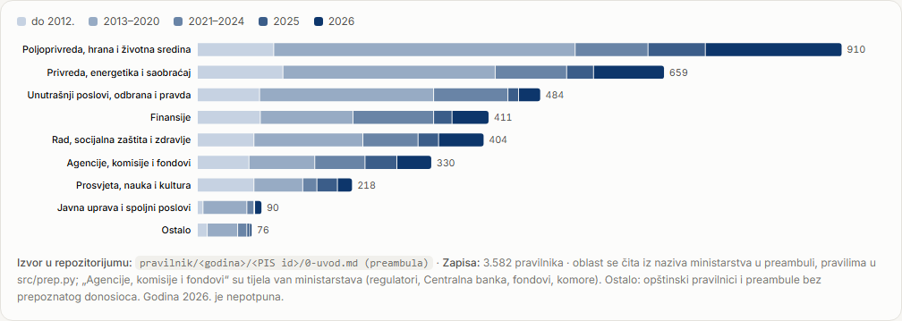

#### 13. Pandemija u Službenom listu

Naredbe i odluke o koronavirusu koje PIS vodi kao važeće, po mjesecu objavljivanja.

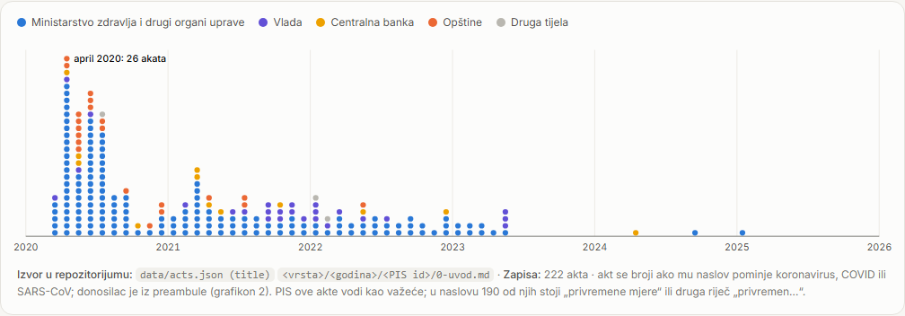

### IV. Ustav, država i novac

#### 14. Ustav

Svaki član Ustava iz 2007. i amandmani iz 2013. i 2026. koji su ga promijenili.

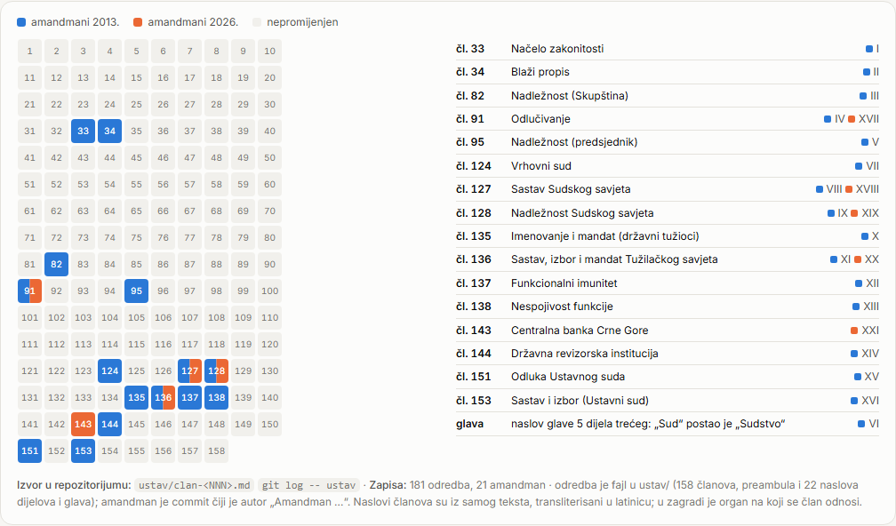

#### 15. Ambasadori po ukazu

Ukazi o postavljenju i opozivu ambasadora, na karti i po godini.

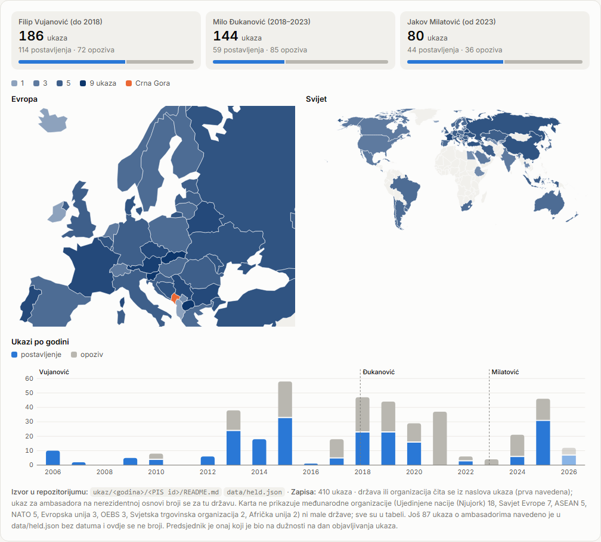

#### 16. Dinar, marka, euro

Valuta novčanih iznosa u važećim aktima objavljenim od 1992. do 2008.

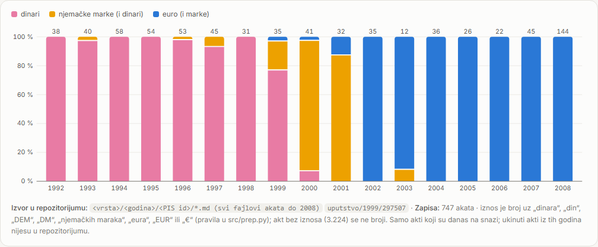

#### 17. Usklađivanje penzija

Svaka važeća odluka o usklađivanju penzija, od hiperinflacije 1993. do tri usklađivanja godišnje.

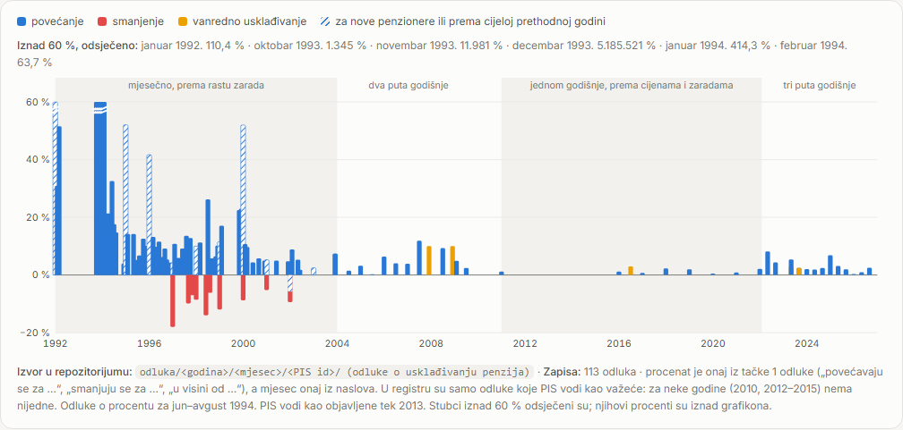

### V. Opštine

#### 18. Opštine

Važeći akti 25 opština, na karti od pločica i po redu.

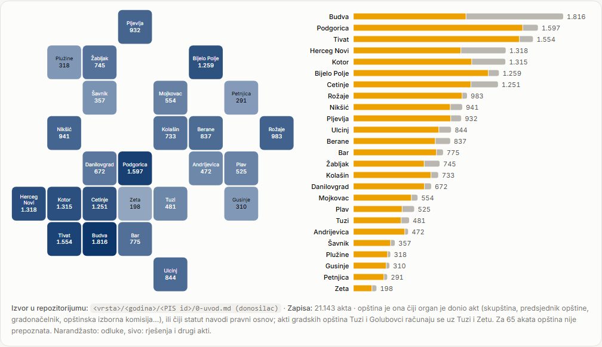

#### 19. Ćirilica po opštinama

Udio akata ćirilicom u svakoj opštini.

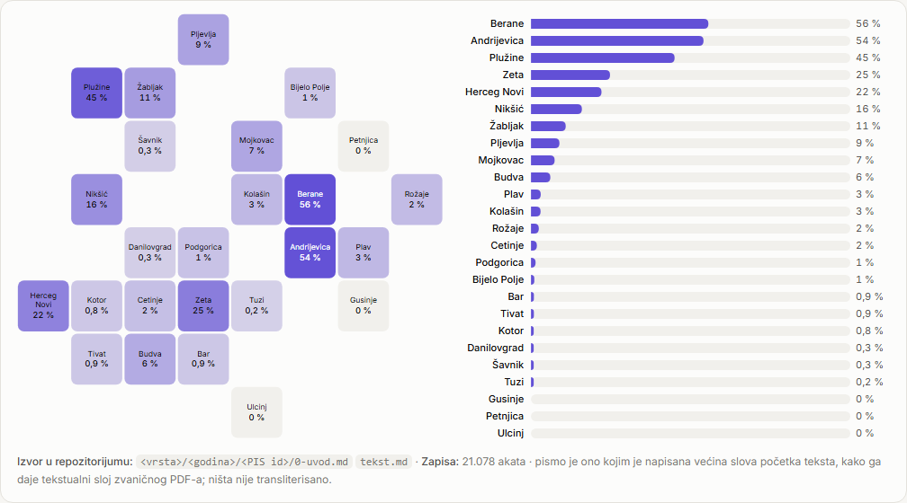

#### 20. O čemu odlučuju opštine

Opštinski akti po temi i godini objavljivanja.

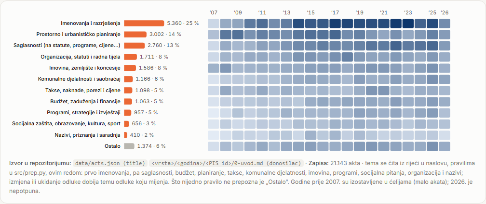

## Podaci

Stanje na commitu `3e92fd62aa` (podaci do 11. novembra 2026).

| Skup podataka | Gdje je u repozitorijumu | Zapisa | Obuhvat |
| --- | --- | ---: | --- |
| Registar važećih akata | [`data/acts.json`](../data/acts.json), `<vrsta>/<godina>/<PIS id>/` | 36.001 akt | akti koje PIS vodi kao važeće, objavljeni 1992–2026, svaki onakav kakav je objavljen |
| Datumi | [`data/laws.csv`](../data/laws.csv) | 36.001 akt | za svaki akt iz registra: dani donošenja, objavljivanja i stupanja na snagu i broj Službenog lista |
| Tekstovi akata | `<vrsta>/<godina>/<PIS id>/*.md` | početak teksta 36.000 akata; cijeli tekst 8.679 akata | cijeli tekst: svi zakoni, uredbe i pravilnici, svi akti objavljeni do 2008. i odluke o usklađivanju penzija |
| Ustav i amandmani | [`ustav/`](../ustav/), istorija gita | 181 odredba (158 članova, preambula i 22 naslova), 21 amandman | 2007, 2013. i 2026. |
| Ukazi o ambasadorima | [`ukaz/`](../ukaz/) | 410 ukaza | 2006–2026, samo metapodaci |
| Važeći akti van repozitorijuma | [`data/held.json`](../data/held.json) | 41.636 akata | razlog za svaki; grafikoni ih ne broje |
| Istorija gita | grana `main` | 41.614 commitova | datum commita je dan stupanja na snagu (`In-force:`) |

## Ograničenja

- **Samo važeći akti.** PIS u repozitorijum daje samo akte koje vodi kao važeće; ukinuti akti i raniji tekstovi nijesu ovdje. Grafikoni po godini ili mjesecu zato pokazuju šta je iz tog vremena ostalo na snazi, a ne koliko je tada objavljeno.
- **Tekst onakav kakav je objavljen.** Službeni list ne objavljuje prečišćene tekstove, pa su izmjene zasebni akti (grafikon 8); samo je Ustav prečišćen u istoriji gita (grafikon 14). Fusnote i potpisi nijesu u tekstu: zvjezdica u naslovu, oznaka prenošenja akta EU, čuva se, a sama fusnota ne (grafikon 9).
- **Kategorije se čitaju iz teksta.** Donosilac (grafikoni 2, 18, 19 i 20), pismo (3 i 19), saziv i zasijedanje (5 i 6), oblast zakona (7), zakon koji se mijenja (8), navodi akata EU (9), pravni osnov (10 i 11), oblast ministarstva (12), akti o koronavirusu (13), država ambasadora (15), valuta (16), procenat usklađivanja penzija (17) i tema opštinskog akta (20) određuju se pravilima u `src/prep.py`. Što nijedno pravilo ne prepozna je „Ostalo“ ili se navodi u napomeni.
- **Preambulu sa sazivom i zasijedanjem** zakoni imaju tek od 2009. (grafikoni 5 i 6).
- **41.636 važećih akata još nije u repozitorijumu** (`data/held.json`); grafikoni ih ne broje, osim u oblačićima grafikona 8 i u napomeni grafikona 15.
- **Nepotpuna godina** (2026) i periodi koji je sadrže nacrtani su svjetlije i tako označeni.

## Kako ponovo napraviti grafikone

```sh
python visualisations/src/make.py                     # git -> src/.build/ -> crnogorsko-pravo-u-20-grafikona.html
python visualisations/src/make.py --ref 3e92fd62aa    # baš ova stranica
node visualisations/src/stills.cjs                    # slike za ove README (treba Playwright; PLAYWRIGHT=<putanja> ako nije globalan)
```

`make.py` čita sve iz objekata gita, pa radi i u klonu bez blobova ili bez checkouta: blobove koje grafikoni čitaju (tabele u `data/`, početak teksta svakog akta, cijeli tekst zakona, uredbi i pravilnika i akata do 2008, Ustav i ukaze) sam preuzima u grupama ako ih nema, a ništa drugo ne preuzima. Podrazumijevano čita `origin/main` (ili `HEAD`); `--ref` bira drugu granu ili commit. U repozitorijum ne upisuje ništa osim stranice i fascikle `src/.build/` (koju git ignoriše).

| Datoteka | Šta radi |
| --- | --- |
| `src/make.py` | preuzima potrebne blobove, izvlači tabele, stablo i istoriju u `src/.build/`, pa pokreće `prep.py` i `build.py` |
| `src/prep.py` | čita tabele i tekstove akata i računa sve brojeve za 20 grafikona i profil podataka u `src/.build/data.json`; sva pravila klasifikacije su ovdje |
| `src/page.tpl.html` | stranica: tekstovi na oba jezika, grafikoni (d3), tabele |
| `src/build.py` | upisuje `data.json` u šablon i zapisuje stranicu |
| `src/stills.cjs` | crta svaki grafikon kao PNG u `stills/cnr/` i `stills/en/` |
