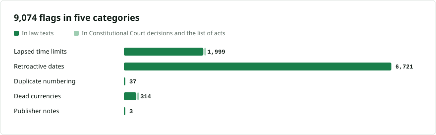

# Vulnerabilities in Montenegrin law

[Crnogorski](README.md) · **English**

<picture>
<source media="(prefers-color-scheme: dark)" srcset="img/flags-by-category-dark.svg">

</picture>

The vulnerability detectors from [lexifina/global-law](https://github.com/lexifina/global-law/tree/main/vulnerabilities) look for mechanical mistakes in legislation: a rule applying "until" a date that has passed, a time limit extended only after it had run out, two amendments to the same act on the same day, an act in force before it was published. global-law's published list (9 November 2026) covered Montenegro with 22 flags from an earlier copy of this repository, so this is a run over this repository only, as it stood at commit [`7849870`](https://github.com/lexifina/montenegro-law/commit/78498703f89cd86b11da1be82f7a1e2c21cec36a) on 15 November 2026, with the more than 36,000 acts from the Službeni list it now holds.

**In short:** the detectors raised 9,977 flags. A language model reviewed 187 of the strongest, arguing each one for and against; 7 survived. Checked by hand in this repository, none is a confirmed drafting mistake, but one stands for a question that reaches thousands of acts. A decision of the President of the Municipality of Rožaje on the "Hajla i Štedim" local location study puts itself in force on the day it was adopted, 16 November 2017, and was published in the Službeni list 351 days later, while Article 146 of the Constitution has laws and other regulations published before they take effect; 6,764 acts here take effect on their adoption day by their own words, before they were published. Of the other six, four are time limits that have run their course (in a COVID-19 order of 2021, twice in a fishing order of 2013, and a transitional deadline of the 2018 Law on Local Self-Government), one is a date the detector misread (it marks which pumps an ecodesign rulebook exempts, not the end of a rule) and one is lawful: an individual decision, not a regulation. The 21 references to repealed placeholders and dead fines, read by hand, are all misread: the article each one cites is in force and speaks of deletion ("brisanje") from a register, of personal data or of a ship. Later, this will be formalised in Lean, similar to our work on [the US tax code](https://lexifina.com/blog/formalizing-the-us-tax-code) and [US case law](https://lexifina.com/blog/formalizing-all-us-case-law-in-lean).

A flag is a prompt to look, not legal advice, and nothing here has been tested in court.

## Flags by category

| Category | What it looks for | Flags | In law texts | Reviewed | Survived review |
| --- | --- | ---: | ---: | ---: | ---: |
| Lapsed time limits | Text still applying a rule "until" a date that has passed | 2,913 | 2,911 | 147 | 5 |
| Retroactive or pre-publication dates | An act in force before it was made or published | 6,721 | 6,721 | 40 | 2 |
| References to repealed placeholders | A provision citing an article whose text is only "deleted" ("brisan") | 20 | 20 | 0 | 0 |
| Dead fines | A penalty for breaching an article that has been deleted | 1 | 1 | 0 | 0 |
| Duplicate numbering | Two units with the same number in one act | 37 | 37 | 0 | 0 |
| Dead currencies | Amounts in currencies no longer in use | 282 | 282 | 0 | 0 |
| Publisher notes | Notes that an amendment could not be carried out | 3 | 3 | 0 | 0 |

"In law texts" counts every act from the Službeni list held here: the Constitution, laws, Government decrees, rulebooks, decisions and rulings, orders, instructions, rules, statutes, programmes, plans and treaties, national and municipal. The other two flags are in two Constitutional Court decisions; the State Election Commission's records, an election-results report and a parliamentary conclusion, which this repository also holds, are counted as not law. The search for same-day conflicts, repeal gaps, empty periods, stale amounts and references to deleted provisions found nothing to flag: apart from the Constitution, every act is held only as published, in one version, and an amending act is an act of its own whose instructions are not applied, so there is no history of changes for those detectors to read. The searches for references to repealed placeholders and for dead fines, which now read this repository's `clan-N` file names as articles, found 21, none of them real: the detector takes "brisanje" (deletion) near the start of a short article for "brisan" (deleted), so it took articles in force on deletion (from a register, of personal data, of a ship) for repealed ones. The lapsed-limit detector reads "do" ("until") before a date, now also with the Montenegrin month names in Latin and Cyrillic script: of the 1,967 phrases "do <day>. <month> <year>" in this repository, 2 are not read, both with the month in the nominative ("do 1. decembar 2026"); of the 102 phrases "do kraja <year>. godine", the 8 written in Cyrillic ("до краја 2018. године") are not read.

*Edge cases: the 7 flags that survived the review, grouped by what they turned out to be, and what the other flags are, in [EDGE-CASES.en.md](EDGE-CASES.en.md).*

## Problems found in this repository

- **Acts missing from its own lists:** 613 act folders at this commit are in none of `ACTS.md`, `data/acts.json` and `data/paths.json`, though the README says `ACTS.md` lists every act and `data/paths.json` maps each act to its folder. They are the 410 presidential decrees (`ukaz/`, held as metadata), 196 acts with text, among them 103 laws (for example [`zakon/2022/319736/`](https://github.com/lexifina/montenegro-law/tree/78498703f89cd86b11da1be82f7a1e2c21cec36a/zakon/2022/319736)), 34 rulebooks and 22 decrees, and 7 metadata records; the README's "36,000 acts" is the 36,001 those lists count.
- **Case law:** the README says case law is not part of this repository, but [`caselaw/`](https://github.com/lexifina/montenegro-law/tree/78498703f89cd86b11da1be82f7a1e2c21cec36a/caselaw) holds two Constitutional Court decisions and 283 records of State Election Commission decisions.
- **Dates going backwards:** the README says `tools/build/check_repo.py` checks that `main` has no dates going backwards; at this commit the commit dates along `main` go back 13 times, each where a batch of appended acts starts again from its oldest act (the check's own count, `git log --first-parent --reverse --format=%ct`).
- **An act named after its promulgation sentence:** [`proglasavam-zakon-o-izvrsenju-odluke-ustavnog-suda-crne-gore-u-i-broj/`](https://github.com/lexifina/montenegro-law/tree/78498703f89cd86b11da1be82f7a1e2c21cec36a/proglasavam-zakon-o-izvrsenju-odluke-ustavnog-suda-crne-gore-u-i-broj) holds the Zakon o izvršenju Odluke Ustavnog suda Crne Gore U-I broj 6/16 under the title "Proglašavam Zakon o izvršenju ...", the President's words of promulgation; the folder name stops at "u-i-broj", and `ACTS.md` lists it as a kind of its own.
- **An act ended by another still in force:** the two licences of the driving school "Marjanović", Pljevlja, have the same title and Gazette issue (97/2023). Point 2 of [the later one](https://github.com/lexifina/montenegro-law/blob/78498703f89cd86b11da1be82f7a1e2c21cec36a/rjesenje/2023/362610/tekst.md), in force from 2 October 2023, ends [the earlier one](https://github.com/lexifina/montenegro-law/blob/78498703f89cd86b11da1be82f7a1e2c21cec36a/rjesenje/2023/362485/tekst.md) (UPI 341/23-4279/1 of 26 July 2023) on that day, yet both are listed in force, and their identical `Law:` trailer makes tools that group by act read them as one.
- **`Enacted:` holding the publication day:** where the adoption day is not known, the `Enacted:` trailer gives the publication day, so some acts look in force before they were made: the [Etički kodeks državnih tužilaca](https://github.com/lexifina/montenegro-law/tree/78498703f89cd86b11da1be82f7a1e2c21cec36a/akt/2025/386211) took effect on 1 November 2025, when the Conference of State Prosecutors adopted it, and its `Enacted:` is 6 November 2025.

## Files

| File | What it holds |
| --- | --- |
| [data/flags.csv](data/flags.csv) | Every flag, one row per act and issue |
| [data/reviewed.csv](data/reviewed.csv) | The 187 flags the model reviewed, with its verdict and reason |
| [data/by_category.csv](data/by_category.csv) | The counts in the table above |
| [tools/](tools/) | The scripts that made this run |

Columns: `category` and `category_cnr` (the category in English and Montenegrin), `detector`, `kind` (`law` or `other`), `path` (the file in this repository; for a retroactive date, the first file of the act), `date` (the date the flag turns on), `reference` (the act or line involved), `summary`, `score` (the detector's ranking, 0 to 1), `review` (`artefact`, `lawful` or `candidate_defect`), `survives_rebuttal`, `review_note` (the model's reason, in English), `url` (the file at the commit that was read, or, for a date flag, the commit that added the act on that day).

## How it was made

- **Detectors:** global-law's [vulnerabilities/scripts](https://github.com/lexifina/global-law/tree/main/vulnerabilities/scripts), run on this repository at commit `7849870`. The history table the detectors read was built from this repository's own commits (the act that made each change, and the `In-force` and `Kind` trailers), counting the `law`, `as-enacted`, `decree` and `treaty` commits as changes to the law. The detectors were then run again, three times, with fixes that read in time limits the Montenegrin month names they did not know ("januara", "februara", "marta", "juna", "jula") and month names in Cyrillic, numeric dates written with spaces, months in Roman numerals and "do kraja" before a year, and that take "DM" as a currency only in capitals and "lira" only at the start of a word; the last run also splits the scans between processes the same way every time and breaks ties between flags with the same score in a fixed order. A last run repeated every step with the newest fixes, keeping every review: "lira" is no longer read inside "liraglutid", nor the Latvian "lati" and "latu" inside words such as "uplati" and "isplatu", and the searches for references to repealed placeholders and for dead fines, which the earlier runs had not repeated, read the `clan-N` file names as articles; run on 16 November 2026, it also counts as lapsed two deadlines of 15 November 2026.
- **Model review:** gpt-5.4-mini, the 40 strongest flags per category, and for lapsed time limits also the 40 strongest in law texts; one pass says whether a flag is real, a second argues that it is not. After the fixes the strongest lapsed time limits were reviewed again, and after each later run the strongest not yet reviewed, keeping the earlier reviews: 117 after those runs, 4 of which had also been among the 40 reviewed before the fixes. The third run reviewed 37 more flags that share the top score, and the last run 32 more; none of them survived. Reviews are now matched to flags on 400 characters of context, not 80, so two flags that shared their first 80 characters with a reviewed flag no longer count as reviewed: 147 in all. The model does not review references to repealed placeholders or dead fines. The detectors found no empty periods, so global-law's review of that category had nothing to read. Where a flag was reviewed twice, the later review is kept. global-law's own list used a different model.
- **Hand check:** every case that survived was read in this repository's texts and history, against the Constitution as this repository holds it, and so were the 21 references to repealed placeholders and dead fines. The open case still needs the Službeni list's own page: its adoption day comes from the signature block, which this repository leaves out. The counts of "do" phrases above are of the phrases on one line of a text, at this commit (`tools/do_gap_check.py`).

To report a correction, open an issue with the provision and an official source.

## Licence

The lists and notes are Lexifina's, dedicated to the public domain under CC0 1.0, like the rest of this repository's own contributions. Quoted text of acts is as the Službeni list Crne Gore publishes it; laws, other regulations and official acts are not protected by copyright under the Zakon o autorskom i srodnim pravima. See [LICENSE](../LICENSE).
