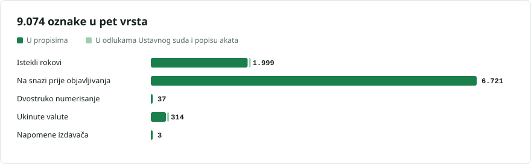

# Ranjivosti u propisima Crne Gore

**Crnogorski** · [English](README.en.md)

<picture>
<source media="(prefers-color-scheme: dark)" srcset="img/flags-by-category-dark.cnr.svg">

</picture>

Detektori ranjivosti iz repozitorijuma [lexifina/global-law](https://github.com/lexifina/global-law/tree/main/vulnerabilities) traže mehaničke greške u propisima: pravilo koje se i dalje primjenjuje „do” datuma koji je prošao, rok produžen tek pošto je istekao, dvije izmjene istog akta istog dana, akt koji je na snazi prije nego što je objavljen. Lista koju je global-law objavio 9. novembra 2026. obuhvatala je Crnu Goru sa 22 oznake, prema ranijoj kopiji ovog repozitorijuma. Ovo je zato provjera samo ovog repozitorijuma, u stanju na commitu [`7849870`](https://github.com/lexifina/montenegro-law/commit/78498703f89cd86b11da1be82f7a1e2c21cec36a) od 15. novembra 2026, sa više od 36.000 akata iz Službenog lista koje sada sadrži.

**Ukratko:** detektori su označili 9.956 mjesta. Jezički model je pregledao 187 najjačih i za svako iznio argumente za i protiv; 7 je izdržalo provjeru. Pregledano ručno u ovom repozitorijumu, nijedno nije potvrđena greška u propisima Crne Gore, ali jedno otvara pitanje koje se tiče hiljada akata. Odluka predsjednika Opštine Rožaje o Lokalnoj studiji lokacije „Hajla i Štedim” stupa na snagu danom donošenja, 16. novembra 2017, a u Službenom listu objavljena je 351 dan kasnije, dok član 146 Ustava propisuje da se zakon i drugi propis objavljuju prije stupanja na snagu; 6.764 akta u ovom repozitorijumu stupaju na snagu danom donošenja, po sopstvenoj odredbi, prije nego što su objavljena. Od preostalih šest oznaka, četiri su rokovi koji su istekli kako je i bilo predviđeno (u naredbi o mjerama protiv COVID-19 iz 2021, dvaput u naredbi o ribolovnim zabranama iz 2013. i prelazni rok iz Zakona o lokalnoj samoupravi iz 2018), jedna je datum koji je detektor pogrešno pročitao (označava koje cirkulacione pumpe pravilnik o eko dizajnu izuzima, a ne kraj nekog pravila), a jedna je zakonita: pojedinačni akt, a ne propis. Nijedna od 21 oznake za upućivanja na odredbe „brisano” i kazne bez opisa prekršaja, pregledane ručno, nije stvarna: član na koji upućuju je na snazi i govori o brisanju iz registra, brisanju ličnih podataka ili brisanju broda. Kasnije će ovo biti formalizovano u Lean-u, slično našem radu na [poreskom zakoniku SAD](https://lexifina.com/blog/formalizing-the-us-tax-code) i [sudskoj praksi SAD](https://lexifina.com/blog/formalizing-all-us-case-law-in-lean).

Oznaka je poziv da se pogleda, a ne pravni savjet, i ništa od ovoga nije provjereno pred sudom.

## Oznake po vrsti

| Vrsta | Šta traži | Oznake | U propisima | Pregledano | Izdržalo pregled |
| --- | --- | ---: | ---: | ---: | ---: |
| Istekli rokovi | Tekst koji i dalje primjenjuje pravilo „do” datuma koji je prošao | 2.913 | 2.911 | 147 | 5 |
| Stupanje na snagu prije objavljivanja | Akt koji je na snazi prije nego što je donesen ili objavljen | 6.721 | 6.721 | 40 | 2 |
| Dvostruko numerisanje | Dvije jedinice sa istim brojem u jednom aktu | 37 | 37 | 0 | 0 |
| Ukinute valute | Iznosi u valutama koje se više ne koriste | 282 | 282 | 0 | 0 |
| Napomene izdavača | Napomene da izmjena nije mogla da se unese | 3 | 3 | 0 | 0 |

„U propisima” obuhvata sve akte iz Službenog lista koji su ovdje: Ustav, zakone, uredbe Vlade, pravilnike, odluke i rješenja, naredbe, uputstva, pravila, statute, programe, planove i međunarodne ugovore, državne i opštinske. Ostale dvije oznake su u dvije odluke Ustavnog suda; zapisi Državne izborne komisije, izvještaj o rezultatima glasanja i zaključak Skupštine, koje ovaj repozitorijum takođe sadrži, ne računaju se kao propisi. Traženje izmjena istog dana, praznina nakon brisanja, praznih perioda, zastarjelih iznosa i upućivanja na brisane odredbe nije našlo ništa: osim Ustava, svaki akt je ovdje samo onakav kakav je objavljen, u jednoj verziji, a akt o izmjenama je zaseban akt čije se odredbe o izmjenama ne primjenjuju, pa ti detektori nemaju istoriju izmjena koju bi čitali. Traženje upućivanja na odredbe „brisano” i kazni bez opisa prekršaja, koje sada nazive datoteka `clan-N` ovog repozitorijuma čita kao članove, našlo je 21 oznaku, nijednu stvarnu: detektor riječ „brisanje” na početku kratkog člana čita kao „brisan”, pa je članove na snazi koji govore o brisanju (iz registra, ličnih podataka, broda) uzeo za brisane. Detektor isteklih rokova čita „do” ispred datuma, sada i sa crnogorskim nazivima mjeseci na latinici i ćirilici: od 1.967 izraza „do <dan>. <mjesec> <godina>” u ovom repozitorijumu nepročitana su 2, oba sa nazivom mjeseca u nominativu („do 1. decembar 2026”); od 102 izraza „do kraja <godina>. godine” nepročitano je 8 napisanih ćirilicom („до краја 2018. године”).

*Granični slučajevi: 7 oznaka koje su izdržale pregled, grupisane prema tome šta su se ispostavile, i šta su ostale oznake, u [EDGE-CASES.md](EDGE-CASES.md).*

## Problemi pronađeni u ovom repozitorijumu

- **Akti kojih nema u sopstvenim spiskovima:** 613 foldera akata na ovom commitu nema ni u `ACTS.md`, ni u `data/acts.json`, ni u `data/paths.json`, iako README kaže da `ACTS.md` navodi sve akte i da `data/paths.json` povezuje svaki akt sa njegovim folderom. To su 410 ukaza predsjednika (`ukaz/`, sačuvanih kao metapodaci), 196 akata sa tekstom, među njima 103 zakona (na primjer [`zakon/2022/319736/`](https://github.com/lexifina/montenegro-law/tree/78498703f89cd86b11da1be82f7a1e2c21cec36a/zakon/2022/319736)), 34 pravilnika i 22 uredbe, i 7 zapisa sa metapodacima; „36.000 akata” iz README-a je 36.001 akt koji ti spiskovi broje.
- **Sudska praksa:** README kaže da sudska praksa nije dio ovog repozitorijuma, ali [`caselaw/`](https://github.com/lexifina/montenegro-law/tree/78498703f89cd86b11da1be82f7a1e2c21cec36a/caselaw) sadrži dvije odluke Ustavnog suda i 283 zapisa o rješenjima Državne izborne komisije.
- **Datumi koji idu unazad:** README kaže da `tools/build/check_repo.py` provjerava da na `main` nema datuma koji idu unazad; na ovom commitu datumi commitova duž `main` idu unazad 13 puta, svaki put gdje grupa dodatih akata ponovo počinje od svog najstarijeg akta (brojano kao u samoj provjeri, `git log --first-parent --reverse --format=%ct`).
- **Akt nazvan po rečenici o proglašenju:** [`proglasavam-zakon-o-izvrsenju-odluke-ustavnog-suda-crne-gore-u-i-broj/`](https://github.com/lexifina/montenegro-law/tree/78498703f89cd86b11da1be82f7a1e2c21cec36a/proglasavam-zakon-o-izvrsenju-odluke-ustavnog-suda-crne-gore-u-i-broj) sadrži Zakon o izvršenju Odluke Ustavnog suda Crne Gore U-I broj 6/16 pod naslovom „Proglašavam Zakon o izvršenju ...”, riječima predsjednika kojima se zakon proglašava; naziv foldera se prekida na „u-i-broj”, a `ACTS.md` ga navodi kao posebnu vrstu akta.
- **Akt koji je drugi akt stavio van snage i dalje je na snazi:** dva rješenja o licenci Auto-škole „Marjanović”, Pljevlja, imaju isti naslov i isti broj Službenog lista (97/2023). Tačka 2 [kasnijeg rješenja](https://github.com/lexifina/montenegro-law/blob/78498703f89cd86b11da1be82f7a1e2c21cec36a/rjesenje/2023/362610/tekst.md), na snazi od 2. oktobra 2023, propisuje da tog dana prestaje da važi [ranije rješenje](https://github.com/lexifina/montenegro-law/blob/78498703f89cd86b11da1be82f7a1e2c21cec36a/rjesenje/2023/362485/tekst.md) (UPI broj 341/23-4279/1 od 26. jula 2023), a ipak su oba navedena kao važeća; zbog istog trailera `Law:` alati koji grupišu po aktu čitaju ih kao jedan akt.
- **`Enacted:` sa danom objavljivanja:** gdje dan donošenja nije poznat, trailer `Enacted:` daje dan objavljivanja, pa neki akti izgledaju kao da su bili na snazi prije nego što su doneseni: [Etički kodeks državnih tužilaca](https://github.com/lexifina/montenegro-law/tree/78498703f89cd86b11da1be82f7a1e2c21cec36a/akt/2025/386211) stupio je na snagu 1. novembra 2025, kada ga je donijela Konferencija državnih tužilaca, a njegov `Enacted:` je 6. novembar 2025.

## Datoteke

| Datoteka | Šta sadrži |
| --- | --- |
| [data/flags.csv](data/flags.csv) | Sve oznake, jedan red po aktu i problemu |
| [data/reviewed.csv](data/reviewed.csv) | 187 oznaka koje je model pregledao, sa ocjenom i obrazloženjem |
| [data/by_category.csv](data/by_category.csv) | Brojevi iz tabele iznad |
| [tools/](tools/) | Skripte kojima je provjera urađena |

Kolone: `category` i `category_cnr` (vrsta na engleskom i crnogorskom), `detector`, `kind` (`law` za propis ili `other`), `path` (datoteka u ovom repozitorijumu; kod stupanja na snagu prije objavljivanja, prva datoteka akta), `date` (datum na koji se oznaka odnosi), `reference` (akt ili red o kojem je riječ), `summary`, `score` (rangiranje detektora, od 0 do 1), `review` (`artefact` za grešku u podacima, `lawful` za zakonito ili `candidate_defect` za moguću grešku), `survives_rebuttal`, `review_note` (obrazloženje modela, na engleskom), `url` (datoteka na commitu koji je pročitan, ili, kod oznaka o datumima, commit kojim je akt dodat za taj dan).

## Kako je urađeno

- **Detektori:** [vulnerabilities/scripts](https://github.com/lexifina/global-law/tree/main/vulnerabilities/scripts) iz repozitorijuma global-law, pokrenuti nad ovim repozitorijumom na commitu `7849870`. Tabela istorije koju detektori čitaju napravljena je iz sopstvenih commitova ovog repozitorijuma (akt koji je donio svaku promjenu i traileri `In-force` i `Kind`), pri čemu se commitovi vrste `law`, `as-enacted`, `decree` i `treaty` računaju kao promjene propisa. Detektori su zatim pokrenuti još tri puta, sa ispravkama zbog kojih se u rokovima čitaju crnogorski nazivi mjeseci koje ranije nijesu prepoznavali („januara”, „februara”, „marta”, „juna”, „jula”) i nazivi mjeseci na ćirilici, datumi brojevima pisani sa razmacima, mjeseci pisani rimskim brojevima i „do kraja” ispred godine, a „DM” se kao valuta čita samo kad je napisano velikim slovima, a „lira” samo na početku riječi; posljednje pokretanje uz to uvijek na isti način dijeli pretragu među procesima i oznake sa istom ocjenom raspoređuje utvrđenim redom. Posljednje pokretanje ponovilo je svaki korak sa najnovijim ispravkama, uz zadržavanje svih pregleda: „lira” se više ne čita u riječi „liraglutid”, ni letonski „lati” i „latu” unutar riječi kao što su „uplati” i „isplatu”, a traženje upućivanja na odredbe „brisano” i kazni bez opisa prekršaja, koje ranija pokretanja nijesu ponavljala, nazive datoteka `clan-N` čita kao članove; pokrenuto je 16. novembra 2026, pa su i dva roka od 15. novembra 2026. označena kao istekla.
- **Pregled modelom:** gpt-5.4-mini, 40 najjačih oznaka po vrsti, a za istekle rokove i 40 najjačih u propisima; jedan prolaz ocjenjuje da li je oznaka stvarna, drugi iznosi argumente da nije. Poslije ispravki najjači istekli rokovi pregledani su ponovo, a poslije svakog sljedećeg pokretanja najjači koji još nijesu bili pregledani, uz zadržavanje ranijih pregleda: 117 poslije tih pokretanja, od kojih su 4 bila i među 40 pregledanih prije ispravki. Treće pokretanje pregledalo je još 37 oznaka sa istom, najvišom ocjenom, a posljednje još 32; nijedna nije izdržala pregled. Pregledi se sada povezuju sa oznakama prema 400 znakova konteksta, a ne prema 80, pa se dvije oznake čijih je prvih 80 znakova isto kao kod neke pregledane više ne računaju kao pregledane: ukupno 147. Model ne pregleda upućivanja na odredbe „brisano” ni kazne bez opisa prekršaja. Detektori nijesu našli prazne periode, pa sopstveni pregled global-law za tu vrstu nije imao šta da čita. Gdje je oznaka pregledana dvaput, zadržan je kasniji pregled. Lista samog global-law napravljena je drugim modelom.
- **Ručna provjera:** svaki slučaj koji je izdržao pregled pročitan je u tekstovima i istoriji ovog repozitorijuma i upoređen sa Ustavom kakav je ovdje, kao i 20 upućivanja na odredbe „brisano” i kazna bez opisa prekršaja koje je dalo ranije pokretanje: nijedna nije bila stvarna, a otkako detektor „brisan” čita samo kao cijelu riječ, više ih nema (vidjeti EDGE-CASES). Za otvoreni slučaj potrebna je još stranica samog Službenog lista: dan donošenja uzet je iz potpisa, koji ovaj repozitorijum izostavlja. Brojevi izraza sa „do” navedeni gore odnose se na izraze u jednom redu teksta, na ovom commitu (`tools/do_gap_check.py`).

Ispravku možete prijaviti otvaranjem issue-a sa odredbom i zvaničnim izvorom.

## Licenca

Liste i napomene su doprinos Lexifine i stavljene su u javno vlasništvo pod licencom CC0 1.0, kao i ostali sopstveni doprinosi ovog repozitorijuma. Citirani tekst akata je onakav kakav ga objavljuje Službeni list Crne Gore; zakoni, drugi propisi i službeni akti nijesu zaštićeni autorskim pravom prema Zakonu o autorskom i srodnim pravima. Vidi [LICENSE](../LICENSE).

Ovo je prevod engleske verzije ([README.en.md](README.en.md)); ako se razlikuju, važi engleska verzija.
